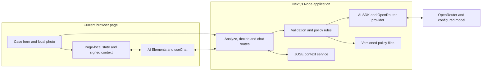
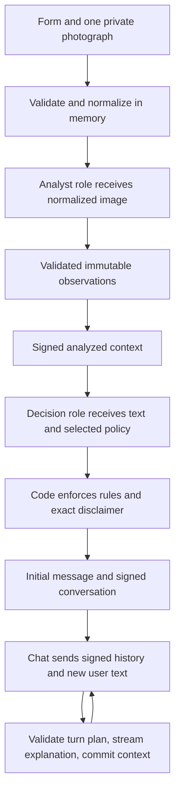
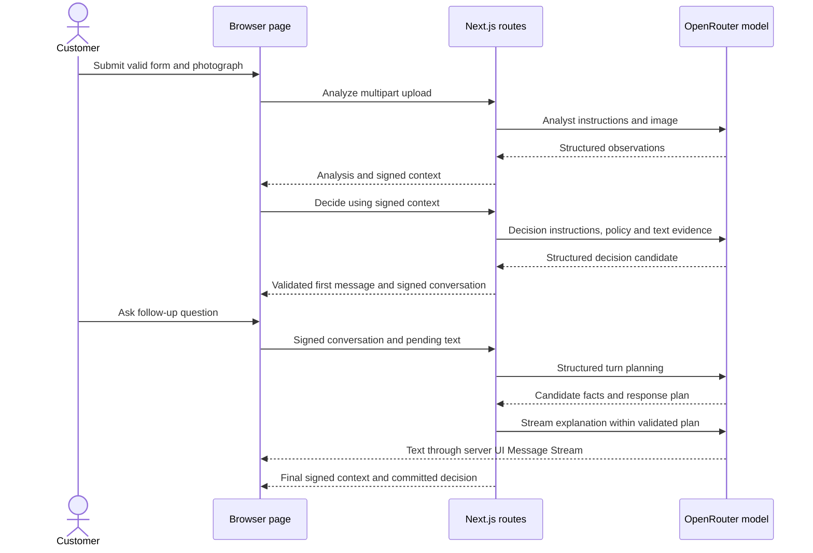

# ADR-000: Hardware Service Decision Copilot — Main Architecture

**Date:** 2026-10-18

**Status:** Accepted for the local course MVP

**PRD:** [Hardware Service Decision Copilot](../PRD.md)

## 1. Overview

Build the Polish return/complaint assistant described in the PRD, starting from the repository's application scaffold. A customer submits one photograph and a form, receives a validated preliminary decision, then discusses that case through a streaming chat. The photograph goes only to the image analyst. The decision role receives its structured description, form data and the applicable company policy.

These records define the future implementation; they do not claim that an application, provider integration or test suite already exists. The inspected `app/` contains only `README.md`.

| Record | Responsibility |
|---|---|
| [001 — Project initialization](001-project-initialization.md) | Empty-app bootstrap, runtime, packages, configuration and commands |
| [002 — Backend and AI](002-backend-and-ai.md) | Contracts, multimodal analysis, policy rules, signed context and streaming |
| [003 — Frontend and chat UI](003-frontend-and-chat-ui.md) | Component comparison, screens, state and endpoint integration |
| [004 — Verification and boundaries](004-verification-and-boundaries.md) | TDD, real-provider evidence, manual QA and known limitations |

### Decisions confirmed by the user

- Run locally on participants' laptops; deployment is a later decision.
- Use Next.js App Router and TypeScript strict mode.
- Use the existing `OPENROUTER_API_KEY` and `LLM_MODEL`; both AI roles use the same configured model.
- Keep case state only in the current browser page; verify server-signed context on subsequent requests.
- Enforce critical policy rules and validate results in code.
- Show the first decision only after complete validation; stream subsequent replies.
- Select the chat UI through research, with reasons recorded in ADR-003.
- Evidence usability has priority over time-window rejection. An unusable photograph or a different device produces Needs information even for an expired case. This resolves the overlap between AC-17/25 and AC-21/23; the latter apply after the evidence gate passes.

## 2. Technology Documentation References

Research was performed on 2026-10-18 using Context7 MCP and the linked primary sources. Context7 IDs below were supplied by the user or resolved successfully. Package versions are research snapshots, not promises about future releases.

| Library or source | Context7 ID or official documentation | Used for |
|---|---|---|
| AI SDK | `/vercel/ai`; [repository](https://github.com/vercel/ai), [docs](https://ai-sdk.dev/docs) | Generation, structured output, transport and UI messages |
| AI SDK 7 migration | [Migration guide](https://ai-sdk.dev/docs/migration-guides/migration-guide-7-0) | Current API patterns and Node requirement |
| Next.js | `/vercel/next.js` | App Router and project initialization |
| OpenRouter provider | [Integration guide](https://openrouter.ai/docs/guides/community/vercel-ai-sdk), [provider repository](https://github.com/OpenRouterTeam/ai-sdk-provider) | Explicit OpenRouter connection |
| OpenRouter APIs | [Docs](https://openrouter.ai/docs), [Responses overview](https://openrouter.ai/docs/api_reference/responses/overview) | API comparison |
| OpenRouter image input | [Image understanding](https://openrouter.ai/docs/guides/overview/multimodal/image-understanding) | Private image input through Chat Completions |
| OpenRouter model catalog | [Public Models API](https://openrouter.ai/api/v1/models) | Configured model capabilities |
| Chat SDK | [chat-sdk.dev](https://chat-sdk.dev/) | Evaluate the supplied alternative |
| Vercel web chat template | [vercel/chatbot](https://github.com/vercel/chatbot) | Evaluate the intended ready-made web application |
| AI Elements | `/vercel/ai-elements` | Selected presentation components |
| assistant-ui | `/assistant-ui/assistant-ui` | Alternative chat runtime and UI |
| JOSE | `/panva/jose` | Signed case and conversation context |
| Sharp | `/lovell/sharp` | In-memory image normalization |

## 3. System Architecture

### Architecture pattern

A single Next.js application with React client components and Node.js Route Handlers. There is no separate backend service, database, object store, account system or agent orchestration platform. The two AI roles are separate bounded calls, not autonomous agents with tools.

| Layer | Technology | Reason |
|---|---|---|
| Runtime | Node.js 24.x, ESM | Supports the current SDK/provider and local development |
| Web application | Next.js App Router, TypeScript strict | Shared types with server-only integration boundaries |
| Styling | Tailwind and selected shadcn/ui primitives | Map the existing Sii tokens to reusable controls |
| Chat presentation | Selected AI Elements components | Streaming Markdown and conversation layout without a second chat runtime |
| Chat state/transport | `useChat`, `DefaultChatTransport` | AI SDK UI Message Stream integration |
| AI calls | AI SDK 7 and `@openrouter/ai-sdk-provider` 3 | Explicit OpenRouter transport with current SDK patterns |
| Validation | Zod | Boundary validation and discriminated structured results |
| Image preparation | Browser preview; Sharp on server | Canonical, metadata-stripped image sent to the model |
| State integrity | `jose`, HS256-signed context | Server-verified context without server session storage |
| Verification | Vitest, Testing Library, Playwright | Domain tests, route tests and the real browser flow |

### Repository structure

| Location | Purpose |
|---|---|
| `app/package.json`, `app/pnpm-lock.yaml` | One application package and its reproducible dependency graph |
| `app/src/app/` | Root layout, single page and API Route Handlers |
| `app/src/components/case/` | Form, processing view, summary and decision cards |
| `app/src/components/chat/` | Controlled composer and transport integration |
| `app/src/components/ai-elements/`, `app/src/components/ui/` | Selected locally owned presentation components |
| `app/src/domain/` | Schemas, policy invariants and calendar-date calculations |
| `app/src/server/` | Environment, policies, prompts, OpenRouter, signatures and orchestration |
| `app/tests/` | Unit, integration, E2E and synthetic fixtures |
| `docs/policies/` | Authoritative example policies; read only by server policy loader |
| `assets/` | Existing design tokens, logo, fonts and visual reference |

The outer `app/` is the package folder; `app/src/app/` is Next.js routing. Do not mistake the two. Do not use `course-materials/` as application input.

## 4. Module Structure & Dependencies

| Module | Responsibilities | Dependencies | Consumers |
|---|---|---|---|
| Domain | Validate inputs and outputs; enforce invariants and policy references | Zod and pure date helpers | Client validation, server services, tests |
| Client case controller | Page-local form, photo, processing and committed conversation | Domain types, browser APIs, transport | Screens and controls |
| Chat transport | Send one pending user turn plus signed context; consume SDK stream | AI SDK UI | Client case controller |
| Route adapters | Validate HTTP inputs, map errors, propagate cancellation | Domain, server services | Browser |
| Image service | Decode/normalize photograph and obtain typed observations | Sharp, analyst instructions, model adapter | Analyze route |
| Decision service | Select policy, obtain candidate, enforce rules and compose decision | Domain, policy loader, model adapter | Decide and chat routes |
| Context service | Verify and sign complete trusted state | JOSE, server configuration | All case routes |
| Model adapter | Instantiate the configured OpenRouter model for each role | Provider, AI SDK, server configuration | Image and decision services |

Dependencies point from UI and routes toward domain/services. Domain code never imports Next.js, React, environment variables or provider clients. Client modules cannot import server modules. Routes never accept a client-supplied policy, system prompt, provider URL or model selection.

## 5. Data Models

| Entity | Key fields and conceptual types | Relationships and lifetime |
|---|---|---|
| CaseForm | Type enum, category enum, model string, purchase calendar date, optional reason | Current page; validated again by server |
| LocalPhoto | File, object URL, name and byte size | Current page only; never embedded in signed conversation |
| ImageAnalysis | Case-discriminated observations from PRD §11.2 | Immutable evidence for the case |
| Decision | Outcome enum, rule identifiers, justification, next steps, missing information, revision | Validated server result; current badge and decision cards |
| SubmittedCase | Form, submission date in Europe/Warsaw, policy version/hash, image analysis | Included in signed context |
| ConversationTurn | Stable message identifiers, user text, completed assistant text, optional decision revision | Complete history carried in signed context |
| SignedContext | Version, purpose/stage, internal nonce, complete committed case/history and signature | Browser memory; sent in JSON bodies, never URLs or cookies |
| PendingTurn | User message identifier and text, transient partial assistant content | Separate from committed signed history until successful finish |

No case or photograph is written to application disk, browser storage, a database or an upload service. Per-request server buffers exist only for processing. External provider retention is a separate boundary; see ADR-004.

## 6. API / Interface Contracts

| Endpoint | Input | Output | Main errors |
|---|---|---|---|
| `POST /api/cases/analyze` | Multipart form fields, exactly one image, remaining initial budget | Validated analysis and analyzed-stage signed context | 400 validation, 413 size, 415 media, 422 decode, 502 provider/schema, 504 timeout |
| `POST /api/cases/decide` | Analyzed-stage signed context and remaining budget | Validated decision, initial assistant UIMessage and chat-stage signed context | 400 schema/stage, 409 policy changed, 422 signature/context, 502 generation, 504 timeout |
| `POST /api/chat` | Chat-stage signed context and one pending text-only user message | AI SDK UI Message Stream, final committed context and decision data | 400 input, 413 request/context size, 409 policy changed, 422 context, 502/504 before stream; SDK error part after stream starts |

All endpoints are same-origin and non-cacheable. They do not expose persistent case lookup. ADR-002 defines payload fields, commit semantics and retry behavior.

## 7. Environment Variables

The existing root [`.env.example`](../../.env.example) contains the first two variables. Initialization must add the signing variable to the application example configuration; this ADR does not edit the existing file.

| Variable | Purpose | Required | Example value |
|---|---|---|---|
| `OPENROUTER_API_KEY` | Server-only OpenRouter bearer credential | Yes for AI calls | `your_api_key_here` |
| `LLM_MODEL` | The same model for analyst, decision and follow-up roles | Yes | `openai/gpt-6-luna` |
| `CASE_SIGNING_SECRET` | Stable local HS256 key across route modules and restarts | Yes for case routes | `replace-with-locally-generated-256-bit-secret` |
| `PORT` | Local Next.js port | No; default 3000 | `3000` |

Put real values in `app/.env.local`, which Next.js loads from the application root. None has a `NEXT_PUBLIC_` prefix. Generate the signing key locally; do not print it into an agent transcript. Never derive it from the OpenRouter key or use a new random key separately in each route module.

## 8. Technical Decisions

### One local Next.js application

**Status:** Accepted

**Date:** 2026-10-18

**Context:** The course starts with no application. The PRD excludes accounts, durable sessions and support handoff.

**Decision:** Initialize a minimal Next.js application under `app/` and keep Node Route Handlers in the same package.

**Rejected alternatives:** Separate frontend/backend services add two runtimes and deployment concerns. A full chatbot starter introduces product features the MVP excludes.

**Consequences:** (+) One local startup and shared contracts. (-) Future hosting and production controls need a separate decision.

**Review trigger:** A request to deploy or add authentication, persistence or staff access.

### AI SDK plus the OpenRouter provider

**Status:** Accepted

**Date:** 2026-10-18

**Context:** Streaming, typed image observations and the configured OpenRouter model are required. The supplied options operate at different layers.

**Decision:** Use AI SDK Core/UI with the explicit OpenRouter chat provider. Do not pass a bare model string to an implicit gateway. The selected upstream endpoint is `https://openrouter.ai/api/v1/chat/completions`.

**Rejected alternatives:** Raw Responses requests require an additional UI stream adapter and offer no required feature beyond the selected path. Chat SDK solves external messaging-platform bots. The web chatbot template adds auth and storage.

**Consequences:** (+) One provider adapter for both roles and SDK-native UI streaming. (-) Package versions and provider capabilities must be verified together.

**Review trigger:** A required model feature exists only on Responses, or the selected provider fails real compatibility tests.

### Comparison of supplied options

The table is an architectural assessment based on the sources in §2, not a benchmark.

| Option | What it provides | Fit for this PRD | Decision |
|---|---|---|---|
| AI SDK Core + UI | Generation/validation primitives and client chat transport; presentation remains separate | Direct fit for image analysis, two roles and progressive chat | Use as integration layer |
| `@openrouter/ai-sdk-provider` | OpenRouter model implementation used by AI SDK | Direct fit for the existing API key/model and image-capable Chat Completions | Use with AI SDK, not as a competing framework |
| OpenRouter Responses API | Alternative stateless inference HTTP contract | Viable, but needs adaptation for `useChat`; provider-specific features are unnecessary here | Retain as a documented alternative |
| `chat-sdk.dev` | Current site describes event-driven bots across messaging platforms | No Slack/Teams/Discord requirement in PRD | Do not initialize from it |
| `vercel/chatbot` | Actual full Next.js web chat starter, including Auth.js, Postgres, Blob and a gateway integration | Useful reference; removing its extra product flows would dominate this small MVP | Do not clone as the app template |

The Responses documentation explicitly rejects `store: true` and non-null `previous_response_id`. Full history must be supplied on every call. It must not be recommended here as hosted conversation storage. The selected provider's [source](https://github.com/OpenRouterTeam/ai-sdk-provider/blob/main/src/provider.ts) independently confirms its OpenRouter base URL and chat-model factory.

## 9. Diagrams

### 9.1 Architecture

### 9.2 Data flow

### 9.3 Main sequence

## 10. Testing Strategy

Use Red → Green → Refactor for runtime implementation. Unit tests cover pure invariants; integration tests use the real application modules and mock only the external LLM boundary; E2E uses the actual local stack and OpenRouter. Real endpoint captures must precede external-response fixtures. See ADR-004 for the full matrix and evidence requirements.

- **TAC-000-01:** All runtime application code is under `app/`; no database, object store or authentication service is required.
- **TAC-000-02:** Both roles resolve to `LLM_MODEL` through the explicitly configured OpenRouter provider.
- **TAC-000-03:** The decision/chat model requests contain no photograph or image URL.
- **TAC-000-04:** Reload, a fresh tab and confirmed new case start empty; no browser storage or cookie restores case state.
- **TAC-000-05:** Unusable/mismatched evidence wins over deadline rejection in the combined boundary tests.
- **TAC-000-06:** Documentation evidence, package compatibility, real-provider behavior and application QA are reported as separate kinds of evidence.
