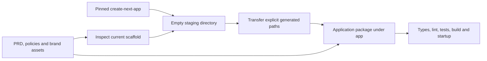
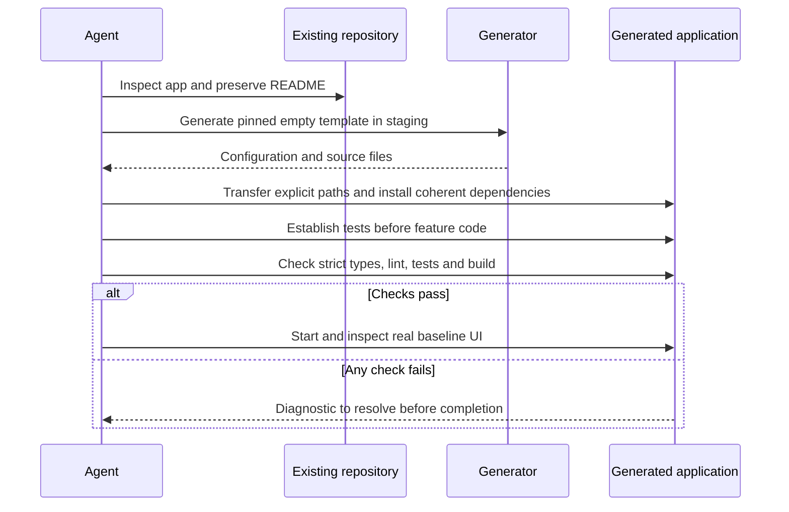

# ADR-001: Initialize the Empty Application

**Date:** 2026-10-18

**Status:** Accepted

**Relates to:** [Main architecture](000-main-architecture.md)

## 1. Scope

Define how the implementing agent creates the Next.js application itself. No initialized template, package manifest, route or test runner may be assumed. This record specifies initialization and verification contracts, not implementation code.

## 2. Technology Documentation References

| Library | Context7 ID or official docs | Used for |
|---|---|---|
| Next.js | `/vercel/next.js`; [create-next-app](https://nextjs.org/docs/app/api-reference/cli/create-next-app) | Official generator and supported options |
| Generator source | [Directory conflict check](https://github.com/vercel/next.js/blob/canary/packages/create-next-app/helpers/is-folder-empty.ts) | Why the current scaffold needs a staging directory |
| AI SDK | `/vercel/ai`; [v7 migration](https://ai-sdk.dev/docs/migration-guides/migration-guide-7-0) | Runtime and current API requirements |
| OpenRouter provider | [README](https://github.com/OpenRouterTeam/ai-sdk-provider) | Supported SDK release line |
| Package metadata | [npm registry](https://registry.npmjs.org/) | Exact release snapshots and peer/engine declarations |
| AI Elements | `/vercel/ai-elements` | Selective component generation |
| Sharp | `/lovell/sharp` | Node-side image normalization |
| JOSE | `/panva/jose` | Context signatures |

## 3. Component Design

### Reproducible baseline

The following releases were observed in public npm metadata on 2026-10-18. Use this coherent baseline for initialization, then record the installed versions in the lockfile. Recheck metadata and docs before intentionally changing a major version.

| Package/runtime | Baseline | Constraint |
|---|---|---|
| Node.js | 24.x | One supported major across laptops; SDK/provider require at least 22 |
| pnpm | 12.14.0 | Declare the package-manager version |
| `create-next-app`, `next` | 16.4.2 | Official stable generator, not canary |
| `ai` | 7.0.143 | Current v7 APIs and ESM |
| `@ai-sdk/react` | 4.0.147 | AI SDK 7 React release line |
| `@openrouter/ai-sdk-provider` | 3.1.0 | Declares `ai ^7.0.0` and Node >=22 |
| `jose` | 6.2.12 | Sign/verify trusted context |
| `vitest` | 5.0.5 | Supports Node 24 |
| `@playwright/test` | 1.64.1 | Browser verification baseline |

Use Zod 4 satisfying the SDK/provider peer requirement of at least 4.1.8. Use the React/React DOM versions generated by the chosen Next.js template, verified against the AI SDK React peer range. Select and lock Sharp, Tailwind, Testing Library and the generated UI dependencies during bootstrap; do not bypass incompatible peer declarations.

### Initialization procedure

1. Inspect `app/` again immediately before generation. Preserve the existing `app/README.md` and all root/course documentation. Stop on unexpected application files rather than replacing them.
2. Create an empty temporary staging directory outside `app/`, with a valid lower-case package name. Generate into that directory using pinned `create-next-app` 16.4.2 through pnpm.
3. Explicitly select TypeScript, App Router, a `src/` directory, Tailwind, ESLint, the `@/*` import alias and pnpm. Select the empty template. Disable nested Git initialization, generated agent instructions and agent feedback. Leave React Compiler and Cache Components disabled for this MVP. Check the pinned generator's help rather than relying on saved local defaults.
4. Transfer the generated package/configuration/source files into `app/` by explicit path. Keep the existing application README; integrate its startup section only after the commands exist. Do not copy a generated `.git` or overwrite repository instructions. Delete only this task's temporary staging files after verification.
5. Install the coherent AI dependency set, Zod, JOSE and Sharp inside `app/`. Initialize shadcn/ui with CSS variables; add only the AI Elements components selected in ADR-003. Use pnpm tooling; do not install a second package manager or global generator.
6. Verify `strict: true` in the generated TypeScript configuration. Keep generated Next.js compiler settings. Add `noUncheckedIndexedAccess` for domain/boundary code and resolve resulting errors; prohibit unvalidated `any` at HTTP and model boundaries.
7. Add meaningful test infrastructure before production feature code: Vitest, DOM test setup and Playwright. Write failing behavior tests from the PRD before implementing each feature.
8. Create ignored `app/.env.local` from the public example variable names. Generate the separate signing secret locally. Extend an example configuration with its placeholder during implementation. Never copy secrets into committed examples.
9. Add explicit scripts for type checking, lint, unit/integration tests, E2E, build and startup. Next.js 16 does not provide `next lint`, and a successful build does not replace lint execution.
10. Verify a production build and start it locally; exercise the baseline screen. Record installed dependency versions and actual script outputs. Do not claim success from the generator's exit status alone.

`create-next-app` checks the target for conflicting files, and `app/README.md` makes the current folder non-empty. Generating blindly into `app/` or the repository root is therefore unsuitable. Staging avoids deleting the scaffold or teaching materials.

### Runtime and source assets

Start all application commands with `app/` as the working directory. The server policy loader resolves `../docs/policies/` from that known root and validates both required files. Load policy content only server-side; no policy path is accepted from HTTP input. Include both files in future deployment packaging if hosting is introduced.

Copy only the required logo, favicon and local Lato fonts from root `assets/` into `app/public/` during initialization, preserving their source attribution. Map design tokens into application CSS variables. Do not include the full homepage screenshot in the runtime bundle. Reuse local fonts rather than adding a build-time network dependency on a font service.

## 4. Data Structures

| Artifact | Contract |
|---|---|
| Package manifest | One package; ESM; Node 24 major; declared pnpm version; explicit scripts |
| Lockfile | Committed `app/pnpm-lock.yaml`; no competing npm/yarn lockfile |
| TypeScript configuration | Strict checking enabled; generated Next.js integration retained |
| Environment schema | Non-empty model/key and correctly sized signing key validated by server modules; no secret values in errors |
| Policy bundle | Both files plus version/hash; no request-time arbitrary path selection |
| UI component registry output | Owned source files and reviewed dependencies, not an opaque full-app template |

## 5. Interface Contracts

The implementing agent must establish these package scripts. They are future interface requirements, not commands verified against an existing application.

| Script | Required behavior |
|---|---|
| `pnpm dev` | Start the local development app on loopback |
| `pnpm typecheck` | TypeScript check without emit |
| `pnpm lint` | Execute ESLint directly |
| `pnpm test` | Deterministic non-watch unit/integration run; report discovered/passed/failed/skipped counts |
| `pnpm test:e2e` | Exercise a running local production app and the real provider; fail clearly when credentials are unavailable |
| `pnpm build` | Create the production Next.js build |
| `pnpm start` | Start the built app on loopback for manual QA |

No real OpenRouter call may occur during static generation or build. Missing runtime configuration must fail clearly at the server boundary before a customer request is sent upstream.

## 6. Technical Decisions

### Official minimal generator instead of a chat application fork

**Status:** Accepted

**Date:** 2026-10-18

**Context:** The application is empty and most screens are case-specific. Existing chatbot templates introduce persistence and account flows.

**Decision:** Use the pinned official Next.js empty template in staging and add only the required integrations.

**Rejected alternatives:** Handwriting every framework configuration risks inconsistent defaults. Forking `vercel/chatbot` requires removing several integrated services.

**Consequences:** (+) Small starting surface and auditable initialization. (-) The agent must add the test harness and case-specific screens.

**Review trigger:** The PRD adds accounts, durable multi-thread history and stored attachments together.

### Current coherent SDK release family

**Status:** Accepted

**Date:** 2026-10-18

**Context:** Current documentation is v7; older examples remain online. The current provider explicitly supports v7.

**Decision:** Use AI SDK 7, React bindings 4 and provider 3 together, on Node 24. Prefer `instructions`, the `stream` result and top-level UI stream helpers. Use canonical file content parts for image bytes.

**Rejected alternatives:** Mixing SDK 7 with an older provider or copying v5/v6 integration examples can produce incorrect types and transport behavior.

**Consequences:** (+) Matches verified current patterns. (-) Registry-generated examples still need review for older API usage.

**Review trigger:** A dependency upgrade changes peer requirements or a selected component fails strict compilation.

## 7. Diagrams

### Initialization architecture and data flow

### Bootstrap sequence

## 8. Testing Strategy

Bootstrap checks are configuration and observable startup checks. Do not add tests that merely mirror package contents. Feature tests begin with the real domain contracts in ADR-002 and the interaction requirements in ADR-003.

| Scenario | Type | Input | Expected output | Edge cases |
|---|---|---|---|---|
| Existing scaffold survives | Diff check | Current `app/README.md` and root documents | Preserved content, no nested Git | Unexpected application files stop transfer |
| Dependency compatibility | Install/type check | Pinned core set | One coherent dependency graph | No suppressed peer conflicts |
| Missing environment | Integration | Missing key/model/signing key | Configuration error without secret disclosure | Placeholder signing key rejected |
| Initial application | Build/start/manual | Installed local package | Root page renders and no console errors | Real fonts/assets resolve |

- **TAC-001-01:** The agent can initialize from the current README-only folder without deleting its contents.
- **TAC-001-02:** Strict type checking and ESLint run independently of production build.
- **TAC-001-03:** All future commands are verified from `app/`; no root package is assumed.
- **TAC-001-04:** No generated `AGENTS.md`, hook, nested repository or unrequested service is introduced.
- **TAC-001-05:** Build and startup do not depend on a live model call or remotely downloaded fonts.
