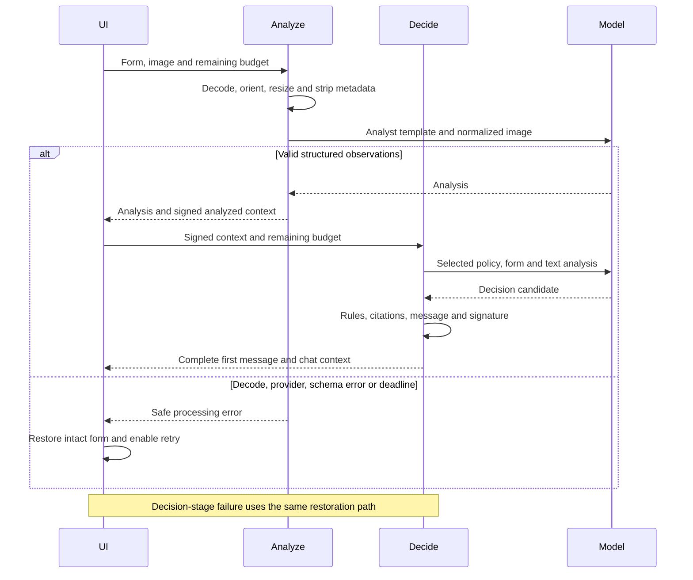
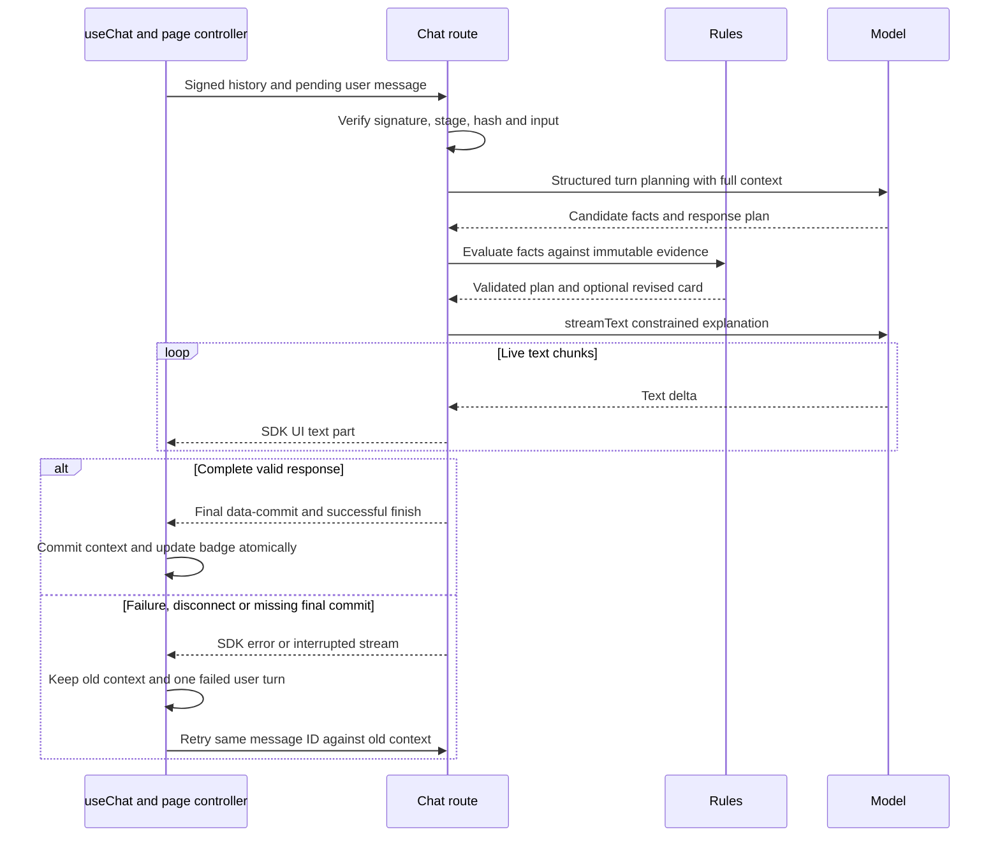
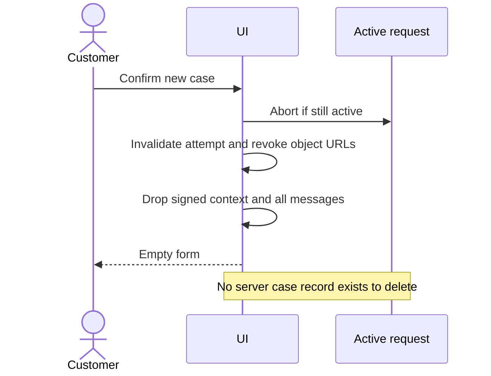

# ADR-002: Backend Contracts, Multimodal Analysis and Streaming Chat

**Date:** 2026-10-18

**Status:** Accepted for the local MVP

**Relates to:** [Main architecture](000-main-architecture.md)

## 1. Scope

Define the form → photograph analysis → preliminary decision → chat pipeline. Cover server validation, OpenRouter integration, policy enforcement, signed client-carried state, failures and cancellation. Presentation and initialization are specified separately.

## 2. Technology Documentation References

| Library/source | Context7 ID or official documentation | Used for |
|---|---|---|
| AI SDK | `/vercel/ai` | Structured generation, messages and streaming |
| SDK 7 | [Migration](https://ai-sdk.dev/docs/migration-guides/migration-guide-7-0) | Current instructions, file parts and stateless response helpers |
| Structured results | [AI SDK structured data](https://ai-sdk.dev/docs/ai-sdk-core/generating-structured-data) | `generateText` with `Output.object` |
| UI transport | [Chatbot](https://ai-sdk.dev/docs/ai-sdk-ui/chatbot), [custom data](https://ai-sdk.dev/docs/ai-sdk-ui/streaming-data) | `useChat`, transport and typed stream events |
| OpenRouter provider | [Guide](https://openrouter.ai/docs/guides/community/vercel-ai-sdk), [source](https://github.com/OpenRouterTeam/ai-sdk-provider/blob/main/src/provider.ts) | Explicit model factory and endpoint |
| OpenRouter multimodal | [Image inputs](https://openrouter.ai/docs/guides/overview/multimodal/image-understanding) | Private image encoding and supported input |
| OpenRouter structured output | [Structured outputs](https://openrouter.ai/docs/guides/features/structured-outputs) | Model/provider support and JSON Schema |
| Model capabilities | [Models API](https://openrouter.ai/api/v1/models) | Verify the configured identifier |
| Alternative API | [Responses overview](https://openrouter.ai/docs/api_reference/responses/overview) | Stateless API alternative |
| JOSE | `/panva/jose` | `SignJWT` and `jwtVerify` |
| Sharp | `/lovell/sharp` | Decode, orientation, resize and metadata removal |

## 3. Component Design

### 3.1 OpenRouter model adapter

Create a server-only provider using `OPENROUTER_API_KEY` and OpenRouter's `https://openrouter.ai/api/v1` base. Select its chat model with exactly `LLM_MODEL`. Do not use an implicit AI Gateway, an OpenAI key, model fallbacks or a browser-side provider. Both roles use the same model but different instructions and inputs.

On the research date, the public catalog lists `openai/gpt-6-luna` with text/image input, text output, `response_format` and `structured_outputs`. This establishes declared capability, not successful account access, schema fidelity, latency or visual accuracy. Before feature completion, execute the synthetic compatibility checks in ADR-004 against the actual configured model and account. A missing/incompatible model produces a configuration/provider failure; do not silently substitute another one.

Require upstream support for the parameters needed for structured responses rather than permitting an endpoint to ignore them. Verify the provider's current routing options when implementing. Disable automatic SDK retries for this bounded MVP; explicit UI retries remain available. Use bounded output sizes: at most 2500 output tokens for analysis, 1500 for initial decision or turn planning, and 1200 for a streamed explanation. Use low reasoning effort where supported and do not request reasoning content in the UI. Validate these limits with real captures; truncation is a failed result, never a partial decision.

### 3.2 Image pipeline

The browser rejects unsupported formats and files over 10,000,000 bytes before upload, and retains the original File and preview for retry. It sends the photograph as multipart binary rather than a large base64 JSON field. A missing file or more than one file is invalid.

The server validates actual decoded JPEG/PNG/WEBP content, not only extension or declared MIME. Sharp corrects orientation, resizes inside a 2048 × 2048 box without enlargement, converts to sRGB JPEG at quality 85, flattens transparency onto white, and omits EXIF/XMP/IPTC metadata. The original is used only for normalization. All upstream image bytes come from the normalized buffer. Resource/decode failures follow AC-38; never send an unnormalized oversized image as a fallback.

Represent normalized image bytes as a canonical AI SDK 7 file content part with an explicit image media type. The provider maps it to OpenRouter's multimodal Chat Completions representation. Private bytes are sent inline; do not create a public URL, upload to Blob, use the provider Files API or allow arbitrary remote image URLs. OpenRouter's raw HTTP representation and the SDK's content representation are different interfaces and must not be mixed.

Choose one of two analyst instruction templates solely from validated case type. Put model/category/reason in labelled user-data fields, never interpolate them as instructions. Complaint analysis receives the stated defect; return analysis receives return-specific observation requirements. Text visible in the photograph is evidence, not authority. The analyst never receives a policy or makes the return/complaint decision.

Use `generateText` with `Output.object` and the appropriate Zod discriminated schema. A successful response must contain every PRD §11.2 field and pass semantic consistency checks. A valid report of an unusable image is a successful analysis and proceeds to Needs information; invalid JSON, missing fields and provider refusal are processing errors.

### 3.3 Initial decision

Verify the analyzed-stage signed context before processing. Select the policy file and decision instructions from its case type. The request contains the validated form, immutable observations, submission date and only the selected policy. No photograph or thumbnail is included.

Use structured generation for a decision candidate, then enforce the policy invariants below. The server validates referenced rule identifiers against the loaded policy, composes the fixed Polish labels, and appends the exact AC-28 disclaimer. The first response is complete JSON; no partial JSON, speculative decision or unvalidated badge reaches the UI.

The first message contains greeting, outcome, justification, numbered next steps and disclaimer in that order. It is seeded into `useChat` as an existing assistant UIMessage; mounting the chat must not generate it again. Its text part contains the canonical complete message for history, and a server-owned `data-decision` part carries the typed card model. The initial-message renderer displays that card instead of also rendering the duplicate canonical text. Updated replies render their streamed explanatory text followed by the committed typed decision card; the canonical signed history contains the complete combined message.

### 3.4 Follow-up planning and live streaming

Every turn carries the full signed committed history plus one new user message. For `useChat`, customize `DefaultChatTransport` request preparation so the HTTP body contains that signed context and pending text-only message. Do not trust a browser-supplied array of assistant messages as canonical history.

Use two bounded phases inside `/api/chat`:

1. **Plan and validate:** `generateText` with `Output.object` extracts candidate policy-relevant facts and classifies the reply as explanation, updated decision, off-topic refusal or unsupported action. Extracted facts include supporting quotations from the new message. Validate dates and evidence references; evaluate the domain rules. Freeze the authoritative decision card and any revised decision before narrative generation.
2. **Stream explanation:** `streamText` receives the complete trusted history, case, selected policy and validated turn plan. It streams a short Polish explanatory answer. The model cannot change the outcome, rule identifiers, required next-step fields or disclaimer through this text channel. These are separate server-owned parts rendered by the UI. Do not forward planning JSON, reasoning traces or internal instructions.

For ordinary answers, convert validated text-only UI messages into model messages using the current `convertToModelMessages` boundary. For the outgoing explanation, transform `result.stream` using the top-level `toUIMessageStream` helper, merge it into a custom UI stream, and return `createUIMessageStreamResponse`. Use the SDK UI Message Stream protocol, not raw OpenRouter SSE or a plain text response. Do not copy deprecated instance response helpers from older examples.

Send a final typed `data-commit` part containing the next signed context and optional updated decision only after the explanation finishes successfully and the complete reply passes validation. Final validation requires non-empty text within the reply/context size limits, a successful non-truncated provider finish, valid card fields and references, and the exact server-owned disclaimer when a decision is issued. The client atomically commits this context, message and badge. A revised decision card ends the reply with the exact disclaimer; any supplementary streamed prose precedes that card. The complete canonical assistant message in signed history includes both the explanation and the server-rendered decision text. Structural validation is not a semantic guarantee about generated prose.

This adds one planning inference to each chat turn. It avoids treating an early model-generated status as an authoritative decision. Free-text accuracy is still probabilistic: typed cards protect state and required wording, while adversarial evaluations verify narrative behavior. A schema alone does not prove that prose contains no misleading promise; see ADR-004.

### 3.5 Time and cancellation

The browser starts a monotonic 90-second deadline at valid submission, before upload. It shows the image-analysis stage while the analyze route runs and the decision stage only after a valid analysis response. The remaining budget is sent to each initial endpoint and capped server-side at 90 seconds. Analysis has a maximum 40-second server budget; reserve at least five seconds of the remaining initial budget for validation, transfer and rendering. Decision uses only what remains.

The analyzed context includes a server-established processing deadline; the decide route cannot extend it through a new client budget. If either request, normalization or client deadline fails, cancel in-flight work, return to the intact form and show AC-38. An explicit retry starts a new complete attempt and a new 90-second budget. Late results from an old attempt cannot overwrite the current page state.

Each chat turn has its own 90-second request deadline including planning and streaming. A stream that starts but stalls still times out. Propagate request disconnects and deadlines into every model call. Abort on confirmed new case/unmount. Do not expose a processing Cancel button, which the PRD does not specify.

### 3.6 Deterministic policy invariants

Use server-derived Europe/Warsaw calendar dates, not elapsed milliseconds or the participant laptop's timezone. Store the submission date in signed context and reuse it for follow-up assessment. Initial purchase dates use the PRD range; chat delivery dates must be explicit, no earlier than purchase and no later than submission. Ask for clarification rather than interpreting an ambiguous date.

| Priority/condition | Enforced behavior |
|---|---|
| Unusable image, no device, category mismatch or confirmed model mismatch | Needs information; applicable evidence rule; new-photo instructions. This gate has precedence over expiry, confirmed by the user. |
| Initial return, days 0–14 | Window open; still evaluate condition/exclusions |
| Initial return, days 15–21 | Needs information, delivery-date question and R-2.2 |
| Initial return, more than 21 days | Rejected with R-2.3; direct to complaint when a defect is described |
| Complaint, strictly after the two-calendar-year anniversary | Rejected with C-2.3 and possible manufacturer's warranty |
| Covered functional complaint within window, usable image and no relevant external cause | Accepted under C-5.1 even when the fault is not photographable |
| Cosmetic damage unrelated to the claimed fault | Cannot alone cause rejection; C-5.4 |
| Packaging absent without another exclusion | Cannot alone cause return rejection; R-3.4 |
| Seal/exclusion cannot be established from available evidence | Needs information, not a guessed exclusion |
| After the evidence/time gates, remaining evidence cannot distinguish acceptance from rejection | Needs information; identify the uncertainty instead of guessing. An unrelated uncertainty does not override a conclusive expiry rule. |
| Pressure, instruction override or unsupported denial of immutable visual findings | Current decision unchanged; explain rule or require a new photo/new case |
| New explicit policy-relevant facts consistent with the evidence | Recompute using validated facts; revision increments only for an updated decision |

Return days are calendar-date differences, inclusive at 14 and 21. Two years means a calendar anniversary, not 730 days; for a leap-day purchase the non-leap anniversary is the last day of February. Record this arithmetic convention in tests. A later delivery date can change the effective date in a follow-up; the initial purchase-date rules must not prevent the PRD's permitted correction flow.

Visible findings remain immutable. A statement that a scratch existed on delivery can be recorded as a user-asserted timing fact; a statement that a detected crack does not exist cannot erase it. LLM classification of cause relevance is a candidate assessment, not independent physical verification. Ambiguous evidence resolves to Needs information.

Policy references must exist in the selected policy. Do not invent an address/contact, shipping action, refund amount or deadline. Use visibly labelled company-contact placeholders until supplied. Describe the policy's 14-day periods with their actual trigger; this assistant does not create a formal return, complaint ticket or receipt date.

### 3.7 Context integrity and lifecycle

Use JOSE HS256 signed JWT payloads with fixed issuer/audience and an allow-list containing only HS256. Decode `CASE_SIGNING_SECRET` from a locally generated base64url value containing at least 32 random bytes. Verify signature, issuer, audience, schema version, stage and policy hash before trusting fields. Do not accept embedded verification keys or algorithms chosen by the client.

The signed payload contains all canonical state needed by the next request, including completed user/assistant history, current decision and validated factual additions. No unsigned form, analysis, status, policy, prior assistant text or model override can replace these fields. A client nonce identifies the page's current attempt; the server also supplies an internal case nonce, never presented as a support ticket.

Keep tokens only in page memory and send them in POST bodies. Signatures provide integrity, not encryption or user identity. There is no database, revocation list, cookie, localStorage, sessionStorage, IndexedDB, cross-tab channel or server session map. JWT claims are readable by the browser.

Do not introduce a time-based chat expiry absent from the PRD. The initial processing deadline applies only to analysis/decision creation. A chat context remains cryptographically usable while its signing key and policy hash remain valid. Resetting the UI discards it, but a deliberately copied token can still be replayed or used to branch from earlier signed history. This local MVP does not promise global revocation or strong identity-based isolation. Revisit before deployment.

Bound signed-context strings to 1 MiB and chat bodies to 2 MiB, checked before expensive validation/inference. Cap a complete assistant reply at 12,000 Unicode code points and validate accumulated context size before commit. If the full history no longer fits these bounds or the model context, preserve it and fail the new turn clearly; do not silently truncate or summarize away earlier facts. These are technical resource limits, not a new persistence feature.

## 4. Data Structures

### Form and observations

Form values follow AC-01–12 exactly: two case types, ten fixed categories, trimmed model 2–100 characters, purchase date 2000-01-01 through submission date, optional return reason up to 2000 characters, required complaint reason 10–2000 characters. Count Unicode code points consistently on client/server; whitespace-only required text is empty.

`ImageAnalysis` is a discriminated union by case type with required fields:

| Group | Fields and conceptual types |
|---|---|
| Common | Image usable boolean; nullable unusable reason enum; device visible boolean; detected device type string; category match enum; model consistency enum; visible surfaces list; findings list; confidence enum |
| Finding | Type enum: scratch/crack/dent/stain/corrosion/missing part/other; location string; severity minor/moderate/severe |
| Return | Condition as-new/minor-handling/visible-use/damaged; signs-of-use list; resellability yes/no/uncertain; packaging visible boolean; seal visible boolean; seal intact yes/no/unknown |
| Complaint | Described defect visible yes/no/partially; likely cause manufacturing/mechanical/liquid/tampering/normal-wear/not-determinable; supporting visible-evidence list |

Use explicit unknown/uncertain values instead of guessing invisible features. A non-visible seal cannot be declared intact. A non-visible device implies an unusable image. Analysis output strings are plain text; render them as text in the summary.

### Decision and conversation

| Structure | Required fields |
|---|---|
| Decision | Outcome accepted/rejected/needs-information; policy reference list of at least one valid identifier; justification string; numbered next-step items; missing-information list; revision integer starting at 1 |
| UserFact | Fact kind; validated value; exact supporting quotation; user-asserted origin; turn identifier |
| TurnPlan | Reply kind; candidate facts; optional candidate decision; preserved evidence references; allowed policy-based next steps |
| CanonicalMessage | Stable identifier; user/assistant role; complete text; optional server-owned decision revision |
| SignedCaseContext | Schema version; analyzed/chat stage; nonce; immutable form/evidence; submission date; policy hash; current decision and complete committed messages for chat stage |
| ErrorEnvelope | Stable machine code; safe Polish message; optional field errors; attempt identifier; retryable boolean |

## 5. Interface Contracts

### `POST /api/cases/analyze`

- **Input:** Multipart form with `caseType`, `category`, `model`, `purchaseDate`, `reason`, one `photo`, `attemptId` and `remainingMs` between 1 and 90000. Reject unknown control fields. Allow multipart overhead separately from the 10 MB image limit; a valid 10 MB file must not fail because the entire body was capped at 10 MB.
- **Output 200:** `analysis`, `signedContext` at analyzed stage, and `attemptId`. JSON only, no original image bytes. The browser already has the preview.
- **Errors:** 400 field validation, 413 file/body size, 415 unsupported decoded format, 422 unreadable image, 502 upstream/refusal/schema validation, 504 deadline. Every processing failure maps to AC-38 while retaining the original client state.

### `POST /api/cases/decide`

- **Input:** `signedContext`, `attemptId`, `remainingMs`. The signed context carries the form/analysis and server deadline; unsigned copies are not accepted.
- **Output 200:** `decision`, fully composed `firstMessage` as assistant UIMessage, and the chat-stage `signedContext` containing that first message.
- **Errors:** 400 invalid schema/stage, 409 policy hash changed, 422 signature/integrity failure, 502 invalid or contradictory generated result, 504 deadline. Do not show a guessed decision on failure.

### `POST /api/chat`

- **Input:** `signedContext`, `message` containing stable `id` and 1–2000 non-whitespace text characters. The adapted transport sends only a new user text turn. Reject file, tool, system, developer, reasoning and assistant parts, arbitrary model settings and unsigned decision replacements.
- **Output 200:** `text/event-stream` in the AI SDK UI Message Stream format. Text parts carry the live explanation. A final `data-commit` contains the next signed context, canonical complete assistant message and optional revised decision. Its envelope/version is schema-validated on both ends.
- **Commit:** Disable another send until a successful finish and valid final commit are both observed. If the connection fails before that point, the old signed context remains authoritative even if partial text or a commit event was received.
- **Failure before headers:** Structured 400/409/413/422/502/504 as appropriate. **Failure after headers:** SDK-compatible error event and stream termination; HTTP status cannot be changed after a 200 stream starts. UI shows AC-39 and does not commit an update.
- **Retry:** Keep one visible user message with its original ID. Remove/replace the failed partial assistant attempt and resend that same message against the last committed context. Use `regenerate` with the adapted transport where supported; verify this exact flow against the pinned SDK. Never append a second user message for retry.

All responses use `Cache-Control: no-store`. Validate the request origin against the actual local application origin and do not enable cross-origin credentialed access. Server error/log records contain stage, code, elapsed time and sanitized provider status, not prompts, photographs, tokens or conversations.

## 6. Technical Decisions

### Bounded role calls with validated structured results

**Status:** Accepted

**Date:** 2026-10-18

**Context:** The PRD separates observation from decision, and the user wants code to enforce critical rules.

**Decision:** Typed observation and decision/turn-plan generation followed by deterministic validation; stream only the follow-up explanation after planning.

**Rejected alternatives:** One unrestricted multimodal chat lets the decision role see the image and blurs role boundaries. A tools-enabled autonomous agent adds actions the product does not perform. Raw JSON text parsing without a schema is not a valid boundary.

**Consequences:** (+) Explicit evidence and policy gates. (-) Follow-up turns require two inferences and narrative evaluation remains necessary.

**Review trigger:** Measured latency exceeds the budget or real evaluations expose systematic visual/policy errors.

### Signed full context without server sessions

**Status:** Accepted

**Date:** 2026-10-18

**Context:** Page-only state is required, and unsigned browser history would allow forged assistant statements.

**Decision:** Verify and re-sign the entire committed case and conversation after successful turns. Use the existing API key only for OpenRouter and a separate stable signing secret for integrity.

**Rejected alternatives:** Unsigned JSON trusts client-modified evidence. Cookies and server maps change the agreed tab-local lifecycle. Signing only the initial analysis leaves later history unprotected.

**Consequences:** (+) Stateless server and tamper detection. (-) Growing request sizes, no global revocation and no prevention of deliberate token copying or replay.

**Review trigger:** Public deployment, audit, identity, server revocation or longer histories become requirements.

### Evidence gate before deadline rejection

**Status:** Accepted by the user

**Date:** 2026-10-18

**Context:** AC-17/25 overlap with AC-21/23 for expired cases with unusable or mismatched evidence.

**Decision:** Apply the evidence gate first; test the combination explicitly.

**Rejected alternatives:** Expiry-first rejection contradicts the user's resolution of the overlap.

**Consequences:** (+) One deterministic precedence for combined conditions. (-) An expired case may request a new photograph before the system rejects it on time grounds.

**Review trigger:** An explicit product/policy change to evidence requirements.

## 7. Diagrams

### Components and data flow

```mermaid
flowchart LR
    Upload[Multipart upload] --> Validate[Schema and image validation]
    Validate --> Normalize[Sharp normalization]
    Normalize --> Analyst[Structured analyst call]
    Analyst --> Signed[Signed immutable observations]
    Signed --> Policy[Selected policy and rule engine]
    Policy --> Candidate[Structured decision candidate]
    Candidate --> Enforce[Enforce outcome and required fields]
    Enforce --> Message[First message and signed history]
    Message --> Chat[Validated chat plan]
    Chat --> Stream[streamText explanation]
    Stream --> Commit[Final signed commit]
```

### Initial submission and failure

### Follow-up and revised decision

### New case and discard

## 8. Testing Strategy

| Scenario | Type | Input | Expected output | Edge cases |
|---|---|---|---|---|
| Image normalization | Unit/integration | Synthetic JPEG/PNG/WEBP | Upstream dimensions <=2048; orientation correct; metadata absent | 10 MB boundary, transparency, corrupt bytes, disguised HEIC |
| Complete schema | Unit/integration | Captured analyst/decision responses | All discriminated fields and valid policy references | Refusal, truncation, missing field, unknown enum |
| Policy invariants | Unit | Dates and typed evidence | Exact expected outcome and rule | 14/15/21/22 days, leap year, expiry plus unusable photo |
| Signature boundary | Integration | Signed context then controlled mutation | Tampering rejected before inference | History/status/stage/hash changes, wrong algorithm/key |
| Role separation | Integration + live capture | Return and complaint | Right instructions/policy; only analyst sees image | Text injection and instructions visible inside image |
| Streaming commit | Integration | Captured events and failures | Progressive text; one atomic final context/badge | Failure before text, mid-stream, after data-commit but before success |
| Follow-up correction | E2E | Explicit later delivery date | Validated updated preliminary decision | Pressure alone; contradictory image claim; ambiguous date |
| Retry and deadline | Integration/E2E | Double click, disconnect or timeout | Preserved form; one visible user turn | Late result, no implicit retries, expired processing token |

Before making external-response mocks, capture a fresh real authorized synthetic request with complete status, headers and body/events. Do not manufacture fixtures from these conceptual contracts. ADR-004 defines evidence handling.

- **TAC-002-01:** No caller-supplied unsigned field can overwrite signed form, observations, history or decision.
- **TAC-002-02:** Every first/updated decision has a valid outcome, selected-policy reference and the exact AC-28 disclaimer.
- **TAC-002-03:** All visual evidence fields from PRD §11.2 exist and remain immutable in chat.
- **TAC-002-04:** Partial streams and failed turns never change committed decision/context.
- **TAC-002-05:** Initial success is visible within 90 seconds; otherwise the intact form and AC-38 appear and upstream work is cancelled.
- **TAC-002-06:** Actual upstream calls use the configured OpenRouter model and Chat Completions endpoint; no gateway or substitute model is used.
- **TAC-002-07:** Retrying a failed turn does not duplicate its user bubble. Stateless retries may incur another inference charge; exactly-once upstream execution is not claimed.
