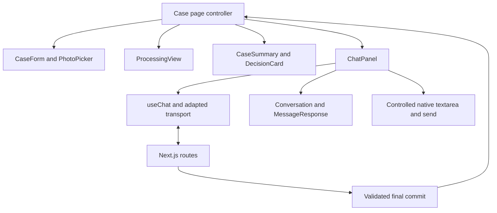
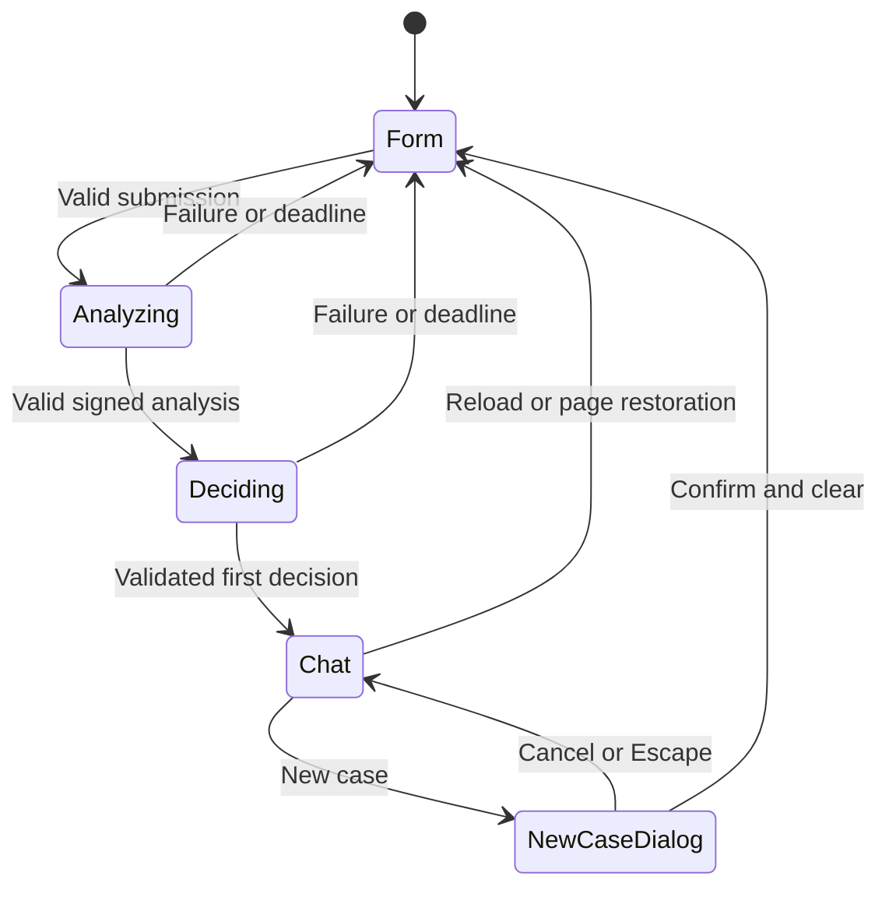
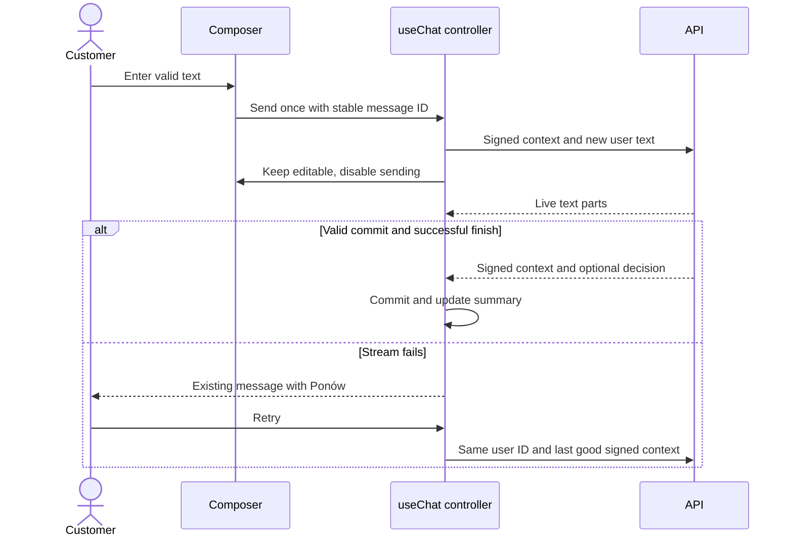

# ADR-003: Frontend State and Streaming Chat Components

**Date:** 2026-10-18

**Status:** Accepted

**Relates to:** [Main architecture](000-main-architecture.md)

## 1. Scope

Choose the chat presentation library and map all PRD screens to state, components and backend contracts. Reuse the existing [design guidelines](../design-guidelines.md), [tokens](../../assets/design-tokens.json) and [homepage reference](../../assets/homepage.png).

## 2. Technology Documentation References

| Library/source | Context7 ID or official docs | Used for |
|---|---|---|
| AI SDK UI | `/vercel/ai`; [Chatbot](https://ai-sdk.dev/docs/ai-sdk-ui/chatbot) | Chat state, transport, retry and message parts |
| AI Elements | `/vercel/ai-elements`; [Conversation](https://elements.ai-sdk.dev/components/conversation), [Message](https://elements.ai-sdk.dev/components/message) | Selected conversation and streaming Markdown presentation |
| Actual registry payloads | [Conversation](https://elements.ai-sdk.dev/api/registry/conversation.json), [Message](https://elements.ai-sdk.dev/api/registry/message.json), [Prompt input](https://elements.ai-sdk.dev/api/registry/prompt-input.json) | Installation dependencies and source review |
| assistant-ui | `/assistant-ui/assistant-ui`; [runtime overview](https://www.assistant-ui.com/docs/runtimes/ai-sdk/overview), [v7 runtime](https://www.assistant-ui.com/docs/runtimes/ai-sdk/v7) | Compare the alternative runtime and component system |
| Next.js | `/vercel/next.js` | Client/server boundaries and root page |
| Browser lifecycle | [MDN beforeunload](https://developer.mozilla.org/en-US/docs/Web/API/Window/beforeunload_event) | Honest navigation-warning limitations |

The comparison was researched through current Context7 documentation and primary component registry/source material on 2026-10-18. Optional Claude consultation through Crossy.ai was checked, but no callable connected Crossy.ai integration was found in this session. No independent Claude opinion is claimed.

## 3. Component Design

### 3.1 Comparison and selection

AI SDK UI supplies transport/state hooks; it does not by itself supply styled chat bubbles and controls. AI Elements supplies locally owned presentation components. assistant-ui adds a chat runtime and richer interaction primitives over an AI SDK backend. Neither replaces the OpenRouter server adapter or implements this PRD's policy rules.

| Criterion | AI SDK UI + selected AI Elements | assistant-ui |
|---|---|---|
| Live streaming | `useChat` state rendered through `MessageResponse` | AI SDK runtime connects to streaming route |
| Existing backend contracts | Direct `DefaultChatTransport` request adaptation | Custom transport supported; extra runtime contract to configure |
| State required by PRD | One linear case conversation plus custom case state | Richer thread/message state; local-only operation is possible |
| Ready interactions | Conversation scrolling and incomplete Markdown rendering; app supplies case controls | More built-in composer, thread, message actions and branching primitives |
| Branding | Source copied into app; CSS variables and classes are directly editable | Also customizable; no need to use hosted services |
| Decision cards and summary | Custom components alongside message text/data parts | Custom message/content rendering possible |
| Features outside this MVP | Exclude export, message variants, attachment controls and reasoning views | Hide thread list, editing, branching, general regeneration and persistence adapters |
| Dependency evidence | Selected registry entries inspected; Message includes Streamdown plugins | Additional runtime integration packages; no measured bundle comparison performed |
| Current version consideration | Some examples still show SDK 6 APIs; adapt to ADR-001's SDK 7 boundary | Current v7 docs use `@assistant-ui/ai-sdk`; old `react-ai-sdk` examples are version-specific |

**Select AI SDK UI plus AI Elements Conversation and Message.** This application has one conversation, custom form/processing/summary screens and strict commit rules for decision updates. Keeping `useChat` as the single chat state owner makes those boundaries explicit. assistant-ui is a reasonable choice for a future multi-thread assistant with message editing and branching, but those capabilities do not reduce the domain-specific work here.

Do not justify the choice with an unmeasured claim that it has the smallest bundle. The inspected Message registry installs code/math/Mermaid/CJK plugins as well as Streamdown; Conversation installs `use-stick-to-bottom`. Review and trim unused presentation/plugin imports in the locally owned source, preserving headings, bold and lists. Type-check against SDK 7; selected entries use SDK message/status types, while example routes may still contain deprecated APIs.

Do not install the complete AI Elements catalog. Also do not select its full PromptInput for this MVP: its registry pulls command, menu, select, hover-card and attachment-oriented presentation. A native controlled textarea with shadcn button/error primitives implements the PRD's 2000-character, editable-during-reply and keyboard requirements more directly.

### 3.2 Screen and endpoint mapping

| PRD step | Components | State/API |
|---|---|---|
| Empty form | `CaseForm`, type radios, category select, date/text fields, `PhotoPicker` | Page-local draft; no request before all fields validate |
| Photograph selected | Thumbnail, filename/size, replace/remove controls, image preview dialog | Local File and object URL; revoke replaced URLs |
| Analyze photograph | `ProcessingView`, image summary, two-stage progress list | Lock submission; call `/api/cases/analyze` |
| Prepare decision | Same processing view; analysis stage done, decision active | Call `/api/cases/decide` with returned signed context |
| Show first decision | `CaseSummary`, `DecisionCard`, Conversation and Message | Seed returned first assistant message; no second generation |
| Ask a question | `ChatComposer`, typing indicator, streaming `MessageResponse` | `useChat` and adapted `DefaultChatTransport` call `/api/chat` |
| Revised decision | `DecisionCard`, updated summary badge | Commit server-owned data only after successful final commit |
| Failed reply | Inline error and `Ponów` beside the existing user turn | Preserve previous signed context; replace failed assistant attempt on retry |
| New case | `NewCaseDialog` | Confirm then abort/drop all page state; cancel preserves it |

### 3.3 State ownership

One client page controller owns draft fields, selected File, preview, current screen, attempt ID, signed context and current committed decision. A mounted chat controller owns `useChat` messages/status and a separate controlled composer draft. Server-rendered layout contains branding and static structure, never case state.

Use explicit states: form → analyzing → deciding → chat. Any initial failure returns to form with the original draft/File intact. The chat has ready/submitted/streaming/error states. During submitted or streaming, keep the textarea editable but disable sending. Store a failed pending turn separately from signed committed history.

Changing case type changes labels, helper text and reason validation; it cannot select instructions directly. The backend revalidates and selects templates. Do not let client summary fields become the authority for later model requests.

Use a single root page for all three screens. Do not place a case nonce, signed token or conversation in a URL. Do not enable stream resumption, persisted thread history, cross-tab synchronization or automatic reload restoration.

### 3.4 Message rendering and interactions

- Render customer text safely as text. Render assistant narrative through streaming-aware `MessageResponse` with raw HTML disabled, remote image rendering disabled and links restricted to safe protocols and approved destinations. Do not fetch arbitrary URLs embedded in a model reply.
- Render a decision with an application-owned component: greeting for the initial decision, exact outcome label, justification with valid policy references, numbered next steps and exact disclaimer. Updated cards have `Zaktualizowana wstępna decyzja`. Their data comes from validated server payloads, not regex extraction from streamed Markdown.
- The summary shows form values, local thumbnail and the current committed badge. Analysis is collapsed initially and translated into readable Polish labels, not raw internal enum values or reasoning traces. Mobile summary is collapsed behind `Szczegóły zgłoszenia`.
- Use Conversation's follow-bottom behavior. Do not force-scroll while the customer reads earlier messages. Show a keyboard-accessible jump-to-latest control.
- The composer supports Enter to send and Shift+Enter for a newline, respecting IME composition. Prevent whitespace-only/over-limit sends on both client/server. Show the counter above 1800 code points. Grow to five lines, then scroll internally.
- Show typing status before text arrives. Announce a concise status rather than every token to assistive technology. Put error text in an appropriate live region and keep focus predictable after submission.
- Implement the exact new-case dialog text/buttons from the PRD. Initial focus is Anuluj; Escape cancels; focus returns to the triggering control. Confirm clears the photograph, all messages, signed context, pending text and current badge.

### 3.5 Brand and accessibility

Use local Lato, text `#2B2B2B`, white and `#F5F9FE` surfaces, brand blue `#0E6EE0`, the violet/blue/cyan primary CTA gradient, 4 px spacing steps, 8 px panels and 20 px pill buttons. Keep the logo top-left, approximately 44 px wide, without recoloring or stretching it. The application's form/summary hierarchy uses the brand's body/card/modal scale; a marketing hero is not required by this PRD.

Prefer at least 16 px text in mobile inputs to avoid browser zoom and maintain legibility, while retaining brand typography elsewhere. Check actual contrast for button text, focus rings and decision badges; semantic labels/icons must distinguish all three outcomes independently of color. Use explicit labels, field descriptions/errors and focus on the first invalid field.

Use a centered single-column form. At widths >=1024 px, chat uses a narrower summary column and a flexible conversation column; below that use one column. Test at 360, 768, 1024 and 1920 px, with long Polish strings and 2000-character messages. Nothing may require horizontal page scrolling.

### 3.6 Leaving and navigation limits

Register `beforeunload` only during processing/chat and after user interaction. Do not navigate between internal URLs for screen transitions. Browser Back that leaves the document uses the same leave-page handler; do not install a history loop that traps the customer.

Browsers control whether a native prompt is displayed and its text; mobile process termination and some navigation/cache paths do not reliably fire the event. Therefore AC-41's absolute cross-browser prompt guarantee cannot be implemented by a web app. Implement and test the supported handler behavior, report browser-specific limitations, and never add persistence as an unapproved workaround. On actual reload or restored back-forward-cache pages, reset to the empty form so an old case is not silently restored.

## 4. Data Structures

| Structure | Owner | Purpose |
|---|---|---|
| CaseViewState | Page controller | Screen, draft, File, preview, attempt, committed context/decision |
| Chat UIMessage | `useChat` | Stable message ID and typed text/data parts |
| PendingTurnState | Chat controller | Original user ID/text, failure and transient assistant attempt |
| DecisionCardModel | Server payload | Validated outcome, references, next steps and revision |
| AnalysisViewModel | Presentation mapping | Polish human-readable labels for immutable analysis |
| ComposerDraft | Chat composer | Editable unsent text independent of current stream |

## 5. Interface Contracts

`CaseForm` emits a validated draft/File only once per active attempt. `ProcessingView` consumes stage/status without choosing provider behavior. `ChatPanel` consumes initial messages, signed context and current decision; it emits a commit only after final context validation and successful completion. `DecisionCard` consumes server-owned data and never parses model text to decide a status.

The transport sends the latest pending user text and the current signed context, not a spread of arbitrary client state. Initialize the hook once for each new case; replacing signed context must not recreate the hook or discard conversation/composer draft. Ignore callbacks carrying an invalidated attempt ID.

## 6. Technical Decisions

### Selected presentation components with one chat runtime

**Status:** Accepted

**Date:** 2026-10-18

**Context:** Most of the UI is a case workflow, while only one area is a conventional chat.

**Decision:** Use AI Elements Conversation/Message over AI SDK `useChat`, with an application-owned composer, summary and decision cards.

**Rejected alternatives:** Bare hooks require rebuilding streaming Markdown and scrolling. assistant-ui provides useful richer interaction state but adds little for this single linear case. A full PromptInput imports controls not needed here.

**Consequences:** (+) Direct control over case state, brand and server commits. (-) Keyboard/composer/error interactions require implementation and testing; generated Markdown dependencies need review.

**Review trigger:** Persistent multi-thread conversations, editing, branching or richer assistant actions are added.

### Complete first decision and guarded follow-up commits

**Status:** Accepted by the user

**Date:** 2026-10-18

**Context:** A partial model response must not become a preliminary outcome. The user accepts a complete validated first message.

**Decision:** Show the initial decision after validation; progressively render follow-up narrative, with authoritative updates committed at successful completion.

**Rejected alternatives:** Deriving badges from early text or partial JSON exposes unstable decisions. Buffering every ordinary reply removes the requested live chat behavior.

**Consequences:** (+) Stable decisions and visible live replies. (-) Processing/typing indicators must cover structured planning latency.

**Review trigger:** A requirement to stream the initial assessment itself.

## 7. Diagrams

### Components and data flow

### Screen state machine

### Send, stream and retry

## 8. Testing Strategy

| Scenario | Type | Input | Expected output | Edge cases |
|---|---|---|---|---|
| Form transitions | Component/E2E | Return/complaint and invalid fields | Correct labels, focus and no invalid request | Missing type; past eligibility date remains valid form input |
| Composer | Component/manual | Enter, Shift+Enter, IME, 2000/2001 characters | Correct send/newline/block behavior | Editable draft survives an in-flight reply |
| Streaming Markdown | Component/live E2E | Incomplete headings/lists and text chunks | Progressive rendered formatting | Unsafe HTML/link/image content is blocked |
| Scroll and summary | Component/manual | Long history, user scrolls up | No forced jump; current decision shown | Mobile collapsed summary and long Polish text |
| Retry/commit | Component/integration | Failed/late/missing commit | One user bubble; old badge retained | New case during request; out-of-order callbacks |
| New case/lifecycle | E2E/manual | Dialog confirm/cancel, reload, Back | Correct clearing/focus and supported warning | Browser prompt suppression documented |
| Brand and keyboard | Manual screenshots | All screens at target widths | Token-aligned appearance and keyboard access | Focus/contrast cannot rely on color alone |

- **TAC-003-01:** All product and assistant text is Polish, including labels derived from internal enums.
- **TAC-003-02:** No upload, export, edit, branch, model-picker or reasoning control appears in the chat.
- **TAC-003-03:** Initial/updated decisions follow AC-27/28/36 and the summary changes only on committed server data.
- **TAC-003-04:** A stream does not lock textarea editing or force-scroll a customer reading older messages.
- **TAC-003-05:** Every touched screen has a rendered screenshot compared with the existing brand reference.
- **TAC-003-06:** AC-41 is reported with actual browser results and the platform limitation, rather than asserted from an installed event handler.
