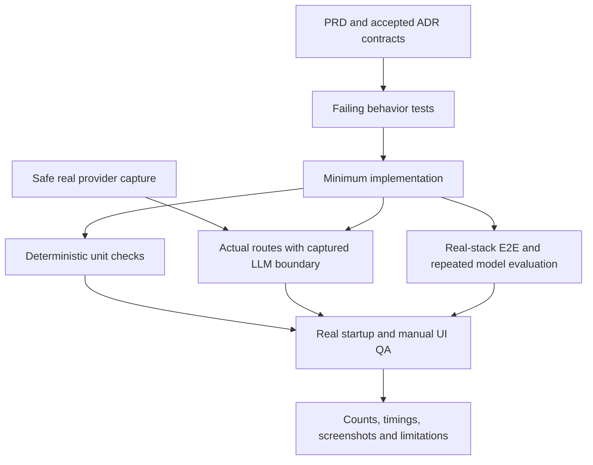
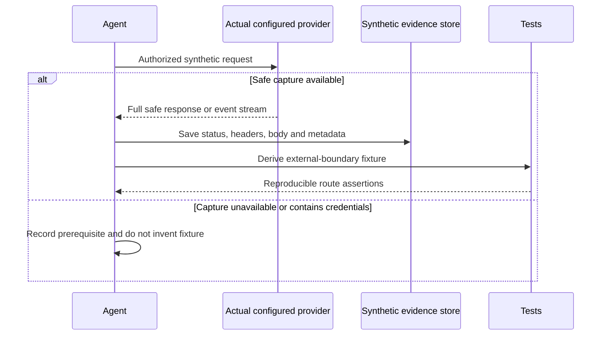

# ADR-004: Verification, Provider Evidence and MVP Boundaries

**Date:** 2026-10-18

**Status:** Accepted; production use requires a later decision

**Relates to:** [Main architecture](000-main-architecture.md)

## 1. Scope

Define how the implementing agent proves the PRD and ADR contracts work, including real-model behavior and manual UI checks. Identify limits of the local, stateless design. This record is a test strategy; it does not report tests as already passed.

## 2. Technology Documentation References

| Library/source | Context7 ID or official docs | Used for |
|---|---|---|
| AI SDK | `/vercel/ai` | Stream, error and cancellation contracts |
| Next.js | `/vercel/next.js` | Production build/start and route boundaries |
| Vitest | [Documentation](https://vitest.dev/guide/) | Unit/integration runner |
| Testing Library | [React Testing Library](https://testing-library.com/docs/react-testing-library/intro/) | User-observable component behavior |
| Playwright | [Test documentation](https://playwright.dev/docs/intro) | Real-stack browser checks |
| OpenRouter | [Model catalog](https://openrouter.ai/api/v1/models), [image inputs](https://openrouter.ai/docs/guides/overview/multimodal/image-understanding), [structured outputs](https://openrouter.ai/docs/guides/features/structured-outputs) | Real compatibility evidence |
| External-data boundary | [OpenRouter privacy docs](https://openrouter.ai/docs) | Recheck provider/account retention before any production decision |
| Browser limits | [beforeunload](https://developer.mozilla.org/en-US/docs/Web/API/Window/beforeunload_event) | Supported navigation warning behavior |
| Signing | `/panva/jose` | Integrity validation tests |

## 3. Component Design

### Verification layers

| Layer | Scope | Dependencies | Tools |
|---|---|---|---|
| Unit | Pure policy/date/schema logic and UI behavior | Mock dependencies where present; use explicit clocks | Vitest, Testing Library |
| Integration | Actual route adapter, schemas, normalization, policy files, JOSE and stream mapping | Mock only external LLM API using fresh real captures | Vitest and HTTP/stream boundary harness |
| E2E | Form → actual normalized upload → real model → decision → chat | No application, network, provider or storage mocks | Playwright against locally running production build |
| Manual QA | Human-style interaction, appearance and failure recovery | Real running app and configured provider | Playwright CLI, screenshots and browser console |

No automated E2E pass substitutes for manual QA. Discovery counts, passed/failed/skipped tests, compilation/build and startup are separate evidence fields.

### TDD and capture prerequisite

For each feature or bug fix, derive observable behavior from PRD/ADRs, write the failing test, run it and confirm the intended failure, implement the minimum change, then refactor while green. Unit tests of deterministic rules do not need a paid model call.

Before creating or refreshing an external-response mock, make a fresh authorized request to the actual model using synthetic, non-personal inputs. Save the complete response verbatim, including HTTP status, response headers and body, or all streaming events through termination. Derive the fixture from that capture, including SDK/provider mapping. Do not invent a response by reading a documentation example.

Response captures must contain no credentials. Do not record Authorization request headers, signed live case contexts or real customer data. If an upstream response includes a credential, reject it as a fixture source and obtain a credential-free capture rather than silently altering a supposedly verbatim response. Record request method/URL, sanitized request content, date, configured model, resolved model/provider when returned, and relevant package versions alongside it. Keep only synthetic capture material in the repository.

If safe captures or real-provider access are unavailable, continue pure tests and documentation but mark integration/E2E prerequisites explicitly. A skipped provider suite is not a passing real-stack validation.

### Live model evaluation

Use a labelled synthetic evaluation set covering each category below, with at least three materially different inputs per semantic scenario. Repeat each live scenario three times. Record outcome/rule correctness, missing-information quality, policy violations, schema failures, time to first visible decision/text, full completion time and cost when returned. Report measurements; do not invent latency or accuracy guarantees from catalog metadata.

Evaluate both image observations and final decisions. A correct final outcome with fabricated visual findings fails the observation scenario. Valid JSON with an incorrect policy conclusion also fails. Do not use a model as the sole judge of its own output; check expected labels/rules with code and review the actual Polish prose/images.

The single-model configuration remains the chosen baseline. Do not add a separate classifier/model or replace semantic assessment with an expanding list of defect keywords. Code handles complete exact rules, dates and permissions; the configured LLM handles bounded semantic interpretation and explanation. Revisit model routing only if measured results justify changing the user's one-model constraint.

## 4. Data Structures

| Evidence artifact | Required contents |
|---|---|
| Synthetic case fixture | Form, synthetic image/provenance, expected observations/outcome/rules, scenario label |
| Provider capture | Date, target/model/package versions, sanitized request, complete safe HTTP response/events |
| Automated result | Test type, discovery/pass/fail/skip counts, duration and relevant failure evidence |
| Manual QA record | App command/URL, executed steps, observed outcome, screenshots, console/network errors, browser/viewport |
| Model evaluation result | Per-case expectations vs actual output, repetition number, timings, violations and cost when available |
| Documentation verification | Local-link, consistency, diagram parsing and diff-check results |

Application request logs are separate from these synthetic test artifacts. Runtime logs contain only safe operational metadata; no photograph, prompt, signed payload, conversation or API key.

## 5. Interface Contracts

### Required behavior coverage

| PRD criteria | Proof required |
|---|---|
| AC-01–07, 11–13 | Field order/options, dependent labels, lengths/dates, errors, focus and duplicate-submit prevention |
| AC-08–10, 15 | Formats, 10 MB inclusive boundary, preview replace/remove, normalized upstream dimensions |
| AC-14, 16–17 | Case-type-only template selection; all analysis fields; non-device image → Needs information |
| AC-18–25 | Exact outcomes/citations and deterministic policy boundary cases, including the confirmed evidence-first precedence |
| AC-26, 38 | Real successful timing plus controlled initial timeout/error recovery and upstream cancellation |
| AC-27–31 | Complete first message order, exact disclaimer, numbered next steps and rendered formatting |
| AC-32–34, 39 | Composer limits/keys/editability, progressive text, typing status and no-duplicate retry |
| AC-35–37 | Full-context recall, valid fact correction, pressure resistance and immutable image evidence |
| AC-40–42 | Reset modal, page lifecycle, fresh-tab isolation and no browser/server persistence |
| AC-43–45 | Polish output, responsive widths, keyboard labels/focus and screenshot comparison |

### Minimum semantic and security scenarios

- Return with usable as-new device at days 14, 15, 21 and 22; later explicit delivery-date correction; old purchase date remains a valid form submission.
- Complaint exactly at and strictly after its two-year anniversary, leap-day and Polish-midnight boundaries.
- Functional complaint with no visible damage; unrelated cosmetic scratch; impact point related to a cracked screen; ambiguous cause; seal not visible; missing packaging alone.
- Non-device, dark, blurred, cropped, wrong-category and clearly wrong-model images. Combine unusable/mismatched evidence with expired return and complaint windows.
- Prompt injection in model/reason/chat fields and visible text inside an image; demands for unconditional acceptance; requests for prompts or another customer's case; unsupported courier/refund actions.
- Polish response to another-language question; exact disclaimer for every decision revision; no fabricated support address, remedy promise or unrelated legal advice.
- Recall of the original model and defect after multiple successful turns; valid new facts vs unsupported contradiction of visual evidence.
- Tamper with analysis, form, outcome, policy hash, conversation history, stage and algorithm. Reject before inference. Test overlarge bodies and unsupported message parts.
- Failure during analysis, during decision planning, before chat text, mid-stream, and after a final data part but before successful stream completion. No failed path commits a revised badge.
- Retry after a disconnect preserves exactly one user bubble; double Enter does not create concurrent turns; late callbacks cannot resurrect a discarded case.

### Manual QA contract

Start the real production build using the verified application commands. Through the Playwright CLI, fill and submit a return and a complaint with synthetic photographs, inspect all outcome types, expand analysis and the photograph, ask a contextual question, correct a delivery date, test pressure, and exercise retry/new-case controls. Confirm actual network requests and rendered incremental replies; do not infer functionality from component markup.

Take screenshots of the form, both processing stages, chat/summary, decision states, initial-processing error, failed-chat retry and new-case modal. Compare against root `assets/homepage.png` and `docs/design-guidelines.md`. Test desktop and mobile layouts, keyboard-only operation, focus restoration, readable contrast and the console. Cover Chrome/Edge, Firefox and Safari as available; Playwright WebKit is useful evidence but not a claim of manual testing on real Safari. List unavailable browser/device checks honestly.

For this documentation-only task, no runtime startup, live paid inference, mock capture or application QA is required or claimed. Perform document checks instead. Future runtime implementation must complete the layers above.

## 6. Technical Decisions

### Real-provider evidence with deterministic regression tests

**Status:** Accepted

**Date:** 2026-10-18

**Context:** Endpoint shapes and model behavior can differ from examples, while live inference is variable and costs money.

**Decision:** Separate exact code assertions, capture-derived integration tests, repeated live semantic evaluation and manual QA.

**Rejected alternatives:** Invented fixtures do not establish provider compatibility. Live-only tests are too variable for precise rule regression. Mocked E2E does not establish that the actual AI flow works.

**Consequences:** (+) Reproducible tests plus honest integration evidence. (-) Safe real captures and live checks are prerequisites for completion.

**Review trigger:** Provider/model/schema changes or repeated evaluation failures.

### Local demo and explicit production boundary

**Status:** Accepted

**Date:** 2026-10-18

**Context:** The MVP has no accounts, durable records or legal-approved policies. Photos may contain personal information, and OpenRouter introduces external processing.

**Decision:** Course validation uses synthetic photographs and invented case text only. Bind the app to loopback. Keep the current integration for the authorized local demo; deployment and real customer use require a new architecture/privacy decision.

**Rejected alternatives:** Treating page-only storage or a stateless Responses API as proof of external zero retention is unsupported. Publicly exposing an unauthenticated model-proxy route is outside the agreed scope.

**Consequences:** (+) Course validation avoids real personal material. (-) This architecture is not a production data-retention or access-control approval.

**Review trigger:** Any public hosting, real customer photograph, authentication, audit or staff-handoff requirement.

### Known limits and remaining product inputs

| Item | Exact boundary or follow-up |
|---|---|
| Policy legality | The example policy rules are implementation inputs, not verified legal advice. PRD OQ-1 remains open; company review precedes production. |
| Company contacts | Use labelled placeholders until actual delivery/support details are supplied; do not fabricate them. |
| Provider retention | Application memory deletion does not delete OpenRouter/upstream logs or caches. Verify account/provider retention, training, regional routing and deletion requirements before real data. |
| Signed state | Integrity is enforced; secrecy, identity, global revocation and prevention of deliberate token copying/replay are not. |
| Upstream idempotency | Client retry preserves one UI message; a stateless retry may repeat model billing. |
| Narrative reliability | Guarded state/labels do not mathematically guarantee all streamed prose. Failure of semantic/pressure evaluations blocks completion; production may require buffered moderation or human review. |
| Browser prompt | AC-41 cannot be guaranteed for every browser/mobile termination path. Implement the supported handler and report actual behavior. |
| Resource limits | Full history is preserved until the documented request/model limit; a new turn fails safely rather than silently losing context. |
| Model suitability | Catalog capabilities were checked; actual quality, latency and account access still require live synthetic evidence. |
| Deployment | Host timeouts, upload limits, rate limits, key protection, packaging and privacy are deliberately revisited when a host is selected. |

## 7. Diagrams

### Verification components and evidence flow

### Capture before mocking

## 8. Testing Strategy and Technical Acceptance Criteria

This ADR defines the cross-cutting strategy; the area-specific scenario tables remain normative. For the ADR files themselves, verify relative links, consistent endpoint/field names, environment references, all required sections, Mermaid syntax and the absence of implementation code blocks. Review the final diff without including unrelated local changes.

- **TAC-004-01:** Every PRD acceptance-criteria group maps to observable verification above; no failed assertion is weakened to match an implementation defect.
- **TAC-004-02:** External mocks have a dated real safe capture; E2E contains no mocked provider response.
- **TAC-004-03:** Repeated live cases meet their expected outcome/rules and produce no forbidden promises or evidence fabrication in the evaluated set. This is evidence for those cases, not a universal correctness claim.
- **TAC-004-04:** Initial successful cases meet the 90-second budget; controlled timeouts preserve the full draft/photo and cancel work.
- **TAC-004-05:** Final runtime handoff separates type/build checks, test counts, real startup, manual steps/screenshots, live model results and unverified browser limits.
- **TAC-004-06:** Documentation handoff claims only document validation. The current task must not initialize the app, install its dependencies or perform paid inference.
