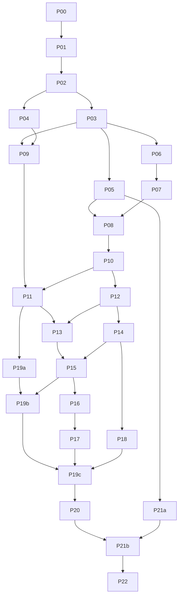

# Hardware Service Decision Copilot — implementation plan

approval: draft

Date: 2026-10-18. This is a future execution procedure, not a task-status tracker or evidence that the application exists.

## Goal, authority and observed starting point

Deliver the complete local Hardware Service Decision Copilot PoC specified in [docs/PRD.md](../PRD.md): a Polish customer submits a return or complaint with one photograph, receives a preliminary policy-based decision, and continues a context-aware conversation that can revise the decision when valid new facts arrive. The coordinator directs three dynamically assigned specialists through small, verified work packages and focused commits.

The user requested a ready-made boilerplate, preferably official AI SDK + Next.js and potentially an OpenRouter starter. The researched draft selects official-team [`vercel-labs/ai-sdk-gateway-demo` at `6fb429b62f1ea8aaea5eee468723d92e61896fd8`](https://github.com/vercel-labs/ai-sdk-gateway-demo/tree/6fb429b62f1ea8aaea5eee468723d92e61896fd8), Apache-2.0; [boilerplate selection](004-boilerplate-selection.md) records four actual comparisons and the exact allow-list. Reuse only its minimal Next/Tailwind/shadcn infrastructure, selected button/card/alert/input primitives and utility. Remove Gateway/generic chat/model/theme/remote-font behavior and align its SDK5/Next15 manifest to accepted SDK7/Next16/OpenRouter3 **before installation**. No compatibility/build/start claim has been made for that adaptation. Adapt the source to the accepted product rather than importing its product scope. At planning inspection, `app/` contained only `README.md`; no application package, scripts, dependencies, routes, tests or runtime were verified.

This planning turn authorizes documents only. Do not initialize the app, install dependencies, call paid models, change runtime/agent configuration, provision secrets or start a server now. Planning-document commit and push on a work branch are authorized; the coordinator performs them after review. No deployment, public hosting or real customer data is authorized. Application execution follows an approved plan and its package prerequisites.

Sources: [repository instructions](../../AGENTS.md), [PRD](../PRD.md), [ADR-001 initialization](../ADR/001-project-initialization.md), [ADR-002 backend/AI](../ADR/002-backend-and-ai.md), [ADR-003 frontend/chat](../ADR/003-frontend-and-chat-ui.md), [ADR-004 verification/boundaries](../ADR/004-verification-and-boundaries.md), [design guidelines](../design-guidelines.md), [reference screenshot](../../assets/homepage.png) and the two [return](../policies/return-policy.md)/[complaint](../policies/complaint-policy.md) policies. Open only the sections named in the selected package. Do not browse or index `course-materials/` as application context.

The detailed execution contracts are [backend packages](001-backend-work-packages.md), [frontend packages](002-frontend-work-packages.md) and [QA packages](003-qa-work-packages.md). This registry owns cross-role scheduling and exact dependencies; the selected specialist package owns its source context, file list, tests and handoff. Resolve a discrepancy in these planning documents before dispatch rather than letting a worker choose an architecture independently.

## Confirmed choices and remaining gates

| Subject | Confirmed direction / required gate |
|---|---|
| Roles/runtime | Dynamically instantiate `fe-developer`, `be-developer`, `qa-engineer` for each focused task. No permanent role files or agent configuration edits. If exact native role types are unavailable, use a native worker with that role in its brief; no model override. Actual dispatch capability is verified in P00, not inferred from a name. |
| Shared checkout | Use this checkout with disjoint path ownership and explicit leases. A branch does not isolate uncommitted files. Do not create a worktree or move/copy the project. |
| Scope/time | Full PRD PoC scope, delivered in working vertical slices. No arbitrary timebox or silent scope reduction. |
| Source | Ready-made official-team donor selected as a draft recommendation: `vercel-labs/ai-sdk-gateway-demo` at the pinned revision above; exact source/licence/allow-list/provenance and adaptation inventory in 004 are P01 inputs. Latest user steering supersedes only conflicting scaffold-acquisition guidance; record the dated ADR-001 clarification explicitly. |
| Models/provider | AI SDK 7, OpenRouter provider 3, `LLM_MODEL=openai/gpt-6-luna` for both roles; only image analyst sees image bytes. No fallback model/gateway or autonomous action tools. |
| Spend | **USD 5 total hard cap**, shared across all roles and every capture/manual/E2E/live-evaluation call and retry. No paid calls in this planning turn. Before execution verify account access and reserve a conservative next-request maximum against the shared ledger; unknown cost is not zero. |
| Publication | Planning-document commit and push on a work branch authorized. Public hosting/deployment/real customer use remain outside this authorization. Runtime publication follows a separately explicit user request where not covered. |
| Data | Synthetic invented text/images only, loopback server, memory-only case lifecycle, no durable customer storage. Safe synthetic evidence has explicit provenance. No credential contents or live signed payload in transcripts/reports. |
| Remaining operational prerequisites | Approved package plan, actual local runtime/tool compatibility, locally provisioned key/signing secret through approved secret workflow, exact provider capability/access, and a feasible budget allocation. These are execution gates, not reasons to leave this draft unfinished. |

The [current Codex subagent documentation](https://learn.chatgpt.com/docs/agent-configuration/subagents) describes native capabilities, but this user chose dynamic task briefs instead of permanent definitions. Do not add `.codex/agents/` files or claim new definitions were loaded into this running session.

## Product and implementation boundaries

Accepted routes are exactly `POST /api/cases/analyze`, `POST /api/cases/decide` and `POST /api/chat`. First decision is whole validated JSON, seeded once into chat. Follow-up has validated structured planning followed by live explanatory text in SDK UI Message Stream format. Only a successful finish plus valid final `data-commit` can atomically change canonical context/message/badge.

Exact policy/date permissions live in code; semantic observations and explanations use the configured bounded model. Evidence usability/category/model mismatch precedes expiry rejection, as explicitly confirmed by the user. Decision and chat roles see only form/analysis/selected policy/full signed canonical history, never image bytes. No unsigned form/history/outcome/model replacement is trusted. Full context is signed for integrity, retained only in page memory, and never silently truncated. No extra accounts, database, persistence, upload service, model selector, raw reasoning display or public image URL is introduced by a starter.

## Phases and reviewable milestones

1. **Foundation:** P00–P04 establish source provenance, an actual starter-derived application, honest test infrastructure, shared contracts and Sii shell. The app starts locally without inference; no course-domain feature is claimed complete.
2. **First-decision destination:** P05–P11 implement actual upload→normalization→analysis→complete initial policy decision and form error recovery. After P11 and P19a the initial decision slice is usable through the real UI. This milestone does not claim follow-up chat.
3. **Interactive demo:** P12/P13 produce a fully working vertical slice: enter a synthetic case, receive the complete first decision and ask an ordinary contextual question with a genuinely progressive Polish reply. The canonical history is signed/committed safely from the first chat slice. Demo evidence includes actual startup, real provider, manual browser interaction and screenshots. P14/P15 extend this with fact-based revisions and comprehensive atomic retry behavior; those features are not claimed at P13 unless separately complete.
4. **Complete PRD acceptance:** P14–P18 and P19b/P19c/P20/P21a/P21b finish revision, pressure resistance, retry, lifecycle, accessibility/security/resource hardening and repeated live evaluation. P22 consolidates all acceptance/evidence. The full PoC is complete only at this milestone, with explicit browser/provider/privacy limits and within the shared cap.

Each milestone must work end to end for its declared behavior. Do not replace a missing endpoint/provider with a mock to obtain a demo. The USD 5 ceiling may prove insufficient for the full required repeated-evaluation matrix; stop before overrun, report exact missing cases and the additional decision needed. Do not shrink the required denominator or label incomplete acceptance as full completion.

## Comprehensive task registry

All application/test paths and commands in the linked packages are proposed until P01/P02 verify them. Dependencies below mean accepted green predecessor handoffs committed by the coordinator. The source-selection artifact is an additional non-package gate on P01. QA may author future-flow failing assertions early; its listed predecessors govern **completion**, not permission to prepare tests.

| ID | Task | Specialist | Exact predecessor IDs | Work package | Focused coordinator commit subject | Required green evidence |
|---|---|---|---|---|---|---|
| P00 | Source/environment/capability preflight | be-developer | none | [BE P00](001-backend-work-packages.md#p00--source-environment-and-capability-preflight) | `Docs: record application execution preflight` | Safe observed checkout/runtime/role/source facts; gates; no credentials read |
| P01 | Acquire/pin/adapt selected starter | be-developer | P00 | [BE P01](001-backend-work-packages.md#p01--acquire-and-adapt-the-pinned-selected-boilerplate-without-scaffold-loss) | `Backend: initialize the pinned application baseline` | Source revision/licence/adaptation inventory, README preserved, compatible lock, type/lint/build/start/baseline manual |
| P02 | Meaningful test and evidence harness | qa-engineer | P00, P01 | [QA P02](003-qa-work-packages.md#p02--minimal-meaningful-verification-harness) | `QA: add bootstrap verification harness` | Real smoke discovery, intentional failing check restored, actual startup/browser screenshot; no invented provider fixtures |
| P03 | Shared typed schemas/contracts | be-developer | P01, P02 | [BE P03](001-backend-work-packages.md#p03--shared-schemas-and-transport-contracts) | `Backend: define validated case and transport contracts` | Behavioral Red/Green boundary assertions, schema/version catalog, FE/QA review, runtime validator smoke |
| P04 | Brand shell/local runtime assets | fe-developer | P01, P02 | [FE P04](002-frontend-work-packages.md#p04--brand-shell-and-runtime-assets) | `Frontend: add Sii brand shell and local assets` | Component tests, local fonts/logo, real 360/1920px shell screenshots and console |
| P05 | Actual safe provider captures | be-developer | P00, P02, P03 | [BE P05](001-backend-work-packages.md#p05--real-synthetic-provider-captures-before-llm-fixtures) | `Backend: capture verified synthetic provider responses` | Complete safe raw HTTP/stream evidence, model/version/date/provenance, derived fixtures and spend ledger |
| P06 | Exact policy/date engine | be-developer | P02, P03 | [BE P06](001-backend-work-packages.md#p06--exact-policy-and-calendar-date-engine) | `Backend: enforce exact policy and calendar boundaries` | 14/15/21/22, anniversary/leap/Warsaw, evidence-first matrix, actual policy/hash CLI evidence |
| P07 | Signed complete context | be-developer | P02, P03, P06 | [BE P07](001-backend-work-packages.md#p07--jose-integrity-for-complete-client-carried-context) | `Backend: sign and verify complete case context` | Real JOSE tamper/stage/hash/algorithm/size tests and safe CLI smoke; full history retained |
| P08 | Image normalization/analyze endpoint | be-developer | P03, P05, P07 | [BE P08](001-backend-work-packages.md#p08--normalize-photographs-and-implement-analyze-route) | `Backend: normalize uploads and analyze device photographs` | Real Sharp/route integration, captured LLM only, local multipart QA/real analyst evidence and cancellation |
| P09 | Case form/photo controls | fe-developer | P03, P04 | [FE P09](002-frontend-work-packages.md#p09--case-form-and-local-photo-selection) | `Frontend: add validated case form and photo controls` | Unicode/validation/File tests, keyboard/focus/preview/size manual QA and screenshots |
| P10 | Complete initial decision endpoint | be-developer | P03, P05, P06, P07, P08 | [BE P10](001-backend-work-packages.md#p10--validate-and-compose-the-complete-initial-decision) | `Backend: validate and compose preliminary case decisions` | Candidate validation, selected policy, exact first message/disclaimer, signed analyze→decide requests |
| P11 | Real initial UI flow | fe-developer | P08, P09, P10 | [FE P11](002-frontend-work-packages.md#p11--processing-and-real-initial-decision-integration) | `Frontend: connect initial case processing and decision` | Real 2-stage flow/≤90s success, one complete seed, preserved File/draft failure, screenshot stages |
| P12 | Planned two-phase ordinary chat | be-developer | P03, P05, P06, P07, P10 | [BE P12](001-backend-work-packages.md#p12--two-phase-chat-with-planned-ordinary-replies) | `Backend: plan and stream context-aware chat replies` | Real SDK stream mapping, full-context recall, validated final commit only after success; real stream QA |
| P13 | Conversation/live transport | fe-developer | P04, P11, P12 | [FE P13](002-frontend-work-packages.md#p13--conversation-presentation-and-narrow-live-transport) | `Frontend: add branded live conversation and transport` | Actual contextual question/progressive text, safe rendering, one message owner, composer/scroll screenshots |
| P14 | Revised decisions/adversarial invariants | be-developer | P05, P06, P07, P10, P12 | [BE P14](001-backend-work-packages.md#p14--revised-decisions-and-adversarial-invariants) | `Backend: validate revised decisions and preserve evidence invariants` | Explicit fact quotes/dates, immutable image, exact revised card/disclaimer, pressure/semantic evidence |
| P15 | Atomic UI commit/retry/composer | fe-developer | P13, P14 | [FE P15](002-frontend-work-packages.md#p15--atomic-commit-chat-errors-retries-and-composer-rules) | `Frontend: guard chat commits and preserve retry turns` | Finish+commit gate, late/error stream matrix, one user ID/bubble, real retry/composer manual QA |
| P16 | Reset and page lifecycle | fe-developer | P15 | [FE P16](002-frontend-work-packages.md#p16--new-case-confirmation-and-page-lifecycle) | `Frontend: reset cases safely across page lifecycle` | Confirm/cancel/reset/abort/no-storage/fresh-tab tests; actual browser prompt evidence and limits |
| P17 | FE safety/accessibility/responsiveness | fe-developer | P16 | [FE P17](002-frontend-work-packages.md#p17--frontend-security-accessibility-and-responsive-hardening) | `Frontend: harden case workflow accessibility and rendering` | Safe markup, labels/keyboard/focus, 360–1920px screenshots, no new console faults |
| P18 | BE timeout/resource/cancellation hardening | be-developer | P08, P10, P12, P14 | [BE P18](001-backend-work-packages.md#p18--backend-timeout-resource-and-cancellation-hardening) | `Backend: harden deadlines resources and cancellation` | Real API resource/abort QA, capture-derived fault matrix, no late commit/auto retry/leaked sensitive logs |
| P19a | Real initial-case acceptance | qa-engineer | P02, P05, P11 | [QA P19a](003-qa-work-packages.md#p19a--real-stack-initial-submission-and-policy-outcomes) | `QA: cover real initial case workflow` | Real production-build E2E, no mocks, return/complaint/outcome/deadline boundaries and early manual gate |
| P19b | Real chat/revision/retry acceptance | qa-engineer | P19a, P12, P13, P14, P15 | [QA P19b](003-qa-work-packages.md#p19b--real-follow-up-atomic-revision-retry-and-full-history-flows) | `QA: cover committed chat updates and retry` | Real full-history/revision/pressure/retry, exactly one user turn, actual event timing |
| P19c | Lifecycle/isolation/trust acceptance | qa-engineer | P19b, P16, P17, P18 | [QA P19c](003-qa-work-packages.md#p19c--real-lifecycle-isolation-and-security-boundary-acceptance) | `QA: verify lifecycle and trust boundaries` | Real reset/tab/storage/origin/tamper/resource checks with honest browser limits |
| P20 | Full manual browser/visual sweep | qa-engineer | P04, P17, P19c | [QA P20](003-qa-work-packages.md#p20--complete-manual-browser-brand-keyboard-and-responsive-acceptance) | `QA: record browser and visual acceptance` | Executed flows/screenshots/brand/keyboard/mobile/desktop/console, actual browser availability |
| P21a | Synthetic evaluation protocol | qa-engineer | P03, P05 | [QA P21a](003-qa-work-packages.md#p21a--synthetic-semantic-evaluation-specification-and-cost-gate) | `QA: define synthetic model evaluation protocol` | Labelled/provenanced ≥3 variants/scenario, 3 repeats plan, code/human judging, remaining USD5 feasibility |
| P21b | Repeated actual model evaluation | qa-engineer | P18, P19c, P20, P21a | [QA P21b](003-qa-work-packages.md#p21b--repeated-live-compatibility-and-semantic-evaluation) | `QA: record repeated synthetic model evaluation` | All required live cases/repeats, observation/outcome/prose/schema/timing/cost results; no forbidden promise/fabrication |
| P22 | Final acceptance/handoff | qa-engineer | P20, P21b; all defect children | [QA P22](003-qa-work-packages.md#p22--final-verification-and-release-handoff) | `QA: document final acceptance and handoff` | Every predecessor transitively green, full AC evidence, final relevant suite/start/manual, cap and caveats |

P19a's predecessors transitively include P03–P10; P19c includes earlier P19 slices; P22's predecessors transitively include every numbered developer package and P21a. “All defect children” is a dynamic release condition: each child has a concrete owning specialist and reproduction; no untracked production fix is allowed. There are no executable generic P19 or P21 tasks in addition to their suffixed entries.

## Dependencies between roles and scheduling waves

Rows are receiving roles; columns are providing roles. Each cell names the time-indexed artifact handoff, rather than granting shared write ownership.

| Receiver ↓ / provider → | be-developer | fe-developer | qa-engineer |
|---|---|---|---|
| be-developer | P03 contracts → P06/P07; P05 captures → P08/P10/P12; P12 → P14/P18 | P11/P13 transport/UI observations; P15 fault contract for joint P18 review where available | P02 harness/capture boundary; early assertions and independently reproduced BE defect children |
| fe-developer | P03 schemas; P08/P10 responses → P11; P12/P14 stream/revision → P13/P15 | P04 shell → P09; P11 → P13; P15 → P16/P17 sequential file handback | P02 component harness; early acceptance assertions, accessibility findings and FE defect children |
| qa-engineer | P05 raw-capture lineage; P06/P07 exact boundaries; P08/P10/P12/P14/P18 implemented API evidence | P11 initial flow; P13/P15 live/retry; P16/P17 lifecycle/safe responsive UI | P02 reusable harness → P19a/b/c; P21a protocol → P21b; prior evidence → P22 |

Cross-role interactions can return to a previous role at a later stage: QA's failed acceptance becomes a new developer defect child, then an independent QA retest. These are time-indexed handoffs with explicit predecessor IDs, not cycles in the task DAG. A review-only FE observation on P18 is not a hidden FE hard prerequisite.

| Producer → consumer | Frozen handoff | Main dependent tasks |
|---|---|---|
| BE → FE/QA | P01 actual layout/scripts/source/lock; P03 schema/version/error/event contract | P02, P04, P09 and all route consumers |
| QA → BE/FE | P02 verified runners/discovery/isolation/evidence/capture boundary, early assertions | P03 onward |
| BE → FE | P08 multipart/analyzed context; P10 complete firstMessage/chat-stage context | P11 |
| BE → FE | P12 request/stream/final commit; P14 fact/revision/immutable-evidence contract | P13, P15 |
| FE → QA | P11 working initial journey; P13/P15 live/retry; P16/P17 lifecycle/a11y | P19a, P19b, P19c, P20 |
| BE → QA | P05 real capture provenance; P06/07 boundaries; P18 failure/cancellation matrix | Integration review, P19c, P21a/b |
| QA → owning dev | Synthetic defect child with exact expected/actual/failing assertion/evidence | Narrow BE or FE fix, independent retest before completion |

At most **one backend, one frontend and one QA worker** may be active together. The coordinator is the manager/reviewer, never a fourth implementation worker. This is a concurrency ceiling, not an instruction to keep all three busy regardless of dependencies. Global verification/browser/budget leases may require all production writers to pause.

1. **Wave 0 — plan/source decision:** complete 004 research and this coordinated draft, dated ADR-001 clarification, document verification and authorized planning publication. No runtime work or paid calls.
2. **Wave 1 — foundation serialization:** P00 then P01, then QA P02. One package/config owner at a time. Verify actual dynamic role dispatch; do not create definitions. No feature worker starts before the harness handoff.
3. **Wave 2 — disjoint foundation branches:** BE P03 and FE P04 can edit disjoint paths; component/manifest installs serialize with QA config. QA prepares independent assertion/evidence plans without endpoint mocks. Gate/commit each green candidate before dependent imports.
4. **Wave 3 — backend contracts/rules/captures and form:** one BE worker completes P05, P06, P07 in a prerequisite-respecting order; P06 can proceed while provider readiness is blocked, P07 follows P06. FE P09 proceeds after P03/P04 with local props/callback tests only. QA prepares P19a tests after P02 and P21a labels; P21a completes after P05 metadata. No invented response to unblock FE.
5. **Wave 4 — initial routes:** BE P08 then P10; FE finishes P09, then P11 only after accepted route handoffs. QA runs each narrow pre-commit gate, then P19a as soon as P11 is integrated. P19a can be authored earlier; its failing future flow is not committed as a Red snapshot.
6. **Wave 5 — interactive chat and corrections:** BE P12 may overlap FE P11 once P10 is committed. FE P13 follows P11/P12; BE P14 can overlap P13 with frozen contracts. The P13 demo is interactive but does not claim unfinished P14/P15 features. FE P15 follows P14/P13; QA P19b follows completed P15. Preparation of pure composer/presentation tests may occur earlier without falsely completing transport/revision work.
7. **Wave 6 — independent hardening:** BE P18 follows server P14 and may run beside FE P15/P16/P17. It uses real HTTP/CLI checks and available UI, without requiring future lifecycle implementation. Full joint lifecycle/atomic acceptance belongs to P19c after both lanes land. QA reviews each commit narrowly, then completes P19c.
8. **Wave 7 — full acceptance:** QA P20 then P21b (with P21a already prepared), under separate runtime and budget reservations; developers only execute narrowly assigned defect children. P22 freezes the final integrated state and records full evidence/limitations. Any later runtime change reopens affected verification.

The logical demo critical path is P00→P01→P02→P03→P06→P07→P08→P10→P12→P13, with P05 provider evidence and P04→P09→P11 as required joining branches. P03 and P06/07/P05 share one backend worker, so backend resource serialization can lengthen this path even where the DAG permits parallel nodes. Full completion adds P14/P15→P16/P17 plus P18, P19b/P19c→P20→P21b→P22. QA/budget access can be the actual bottleneck; this plan gives no invented duration estimate.



The diagram shows the reduced dependency graph for readability; the registry's exact predecessor sets govern dispatch. Numeric order alone creates no edge. In particular P02 never depends on P05; P17 does not depend on final QA that requires P17; P18 does not wait for FE lifecycle; there is no cycle.

## File, configuration, runtime and Git leases

| Resource | Lease/ownership rule |
|---|---|
| Feature source/tests | Exact proposed paths in one selected work package; no agent writes another agent's files, reverts unrelated changes or silently expands scope. Sequential amendments require explicit handback. |
| Shared contracts | BE P03 owns `app/src/domain/contracts/**`; FE/QA import read-only. Freeze schema/version/envelope before concurrent consumers; amendments serialize with a consumer migration handoff. |
| Packages/lock/config | One named lease over `app/package.json`, `app/pnpm-lock.yaml`, Next/TypeScript/lint/test configs and component installation. P01 allow-listed acquisition/provenance/manifest adaptation→P02 harness→P04 selected component/brand work. No concurrent install, competing lockfile or suppressed peer conflict. |
| Tests/captures | Developers own their lower-layer tests; QA owns `app/tests/e2e/**` and independent evaluation. Only BE owns raw safe provider captures under `app/tests/evidence/provider-captures/`. QA can request capture corrections, not edit originals. |
| Reports/screenshots | Transient manual evidence in proposed gitignored `app/test-results/manual/<task-id>/`; durable safe summaries under `docs/verification/`. No browser profiles/traces/cache blanket staging. |
| Runtime/port | Coordinator reserves one actual loopback port and process owner for build/start/manual gate. Stop prior task server cleanly before next run; no tests against stale dev/build output or another worker's server. |
| Budget/provider | Single coordinator ledger with task/request reservation, estimated maximum, actual usage/cost, retries and remaining USD5. No concurrent unreserved model runs. Capture-derived deterministic tests spend no provider money. |
| Git | Coordinator alone reviews status/diff, stages explicit safe owned paths and commits/pushes within authorization. Workers do not stage, commit, push, switch branches, stash, reset or clean shared work. |

Before typecheck, build, startup, manual QA or commit, use a **paused-writer green verification barrier**: ask active workers to stop at green checkpoints, enumerate the candidate's owned and unrelated dirty paths, freeze its diff/tree identity, confirm required predecessor commits/handoffs, reserve configuration/port/budget, and perform relevant checks against that immutable state. Do not build against half-written unrelated features or attribute a result to a different candidate. If the candidate changes, rerun affected checks.

A task may not import, depend on or claim completion using another task's uncommitted files. Add the true predecessor and have the coordinator verify/commit it first. Other disjoint work must be at a declared green checkpoint; if a coherent candidate cannot be verified without unrelated unfinished work, wait for the owner to finish or split at a naturally green boundary. Do not stash/reset/overwrite another worker to force a clean gate. Resume editing only after the coordinator releases the barrier. Focused commits remain separate even when independent packages share one coordinated freeze.

The coordinator implements no app code or production fixes. All application changes go to `be-developer` or `fe-developer`; QA configures tests, writes test/evaluation/report code and independently checks them. A QA finding creates a focused defect child for the owning developer. The coordinator may perform review, commands/checks, lease allocation and Git operations only.

## Dispatch protocol and exact common brief

Dispatch exactly **one registry entry** per worker task. Include only its named source sections, immediate existing call sites, owned outputs/tests, forbidden paths and accepted prior handoff; do not paste all planning documents or the whole PRD. Use this common brief unchanged except bracketed task-specific values:

```text
You are [fe-developer | be-developer | qa-engineer] for task [ONE registry ID/title].
execution_mode: [planning review | approved implementation]
The coordinator owns tracking, leases, review, verification scheduling and Git;
it does not implement. You are not alone in this shared checkout. Preserve others'
changes; edit only the exact leased paths below. Do not spawn agents, switch branch,
create a worktree, stage, commit, push, stash, reset or clean shared state.

Goal and expected behavior: [selected package's concrete slice, inputs and outputs].
Source context: [only listed headings/AC IDs + relevant immediate call sites].
Accepted predecessor commits/handoffs: [IDs, revisions, schema/event/capture versions].
Owned production files: [exact selected-package proposed paths, verified at preflight].
Owned tests/evidence: [exact paths]. Forbidden/shared read-only paths: [exact list].
Active leases and expiry/handback: [feature/config/schema/runtime/budget reservation].

Use actual installed runtime/scripts and current Context7 docs for library APIs.
Derive observable assertions from the specification; write/run the intended Red
before production behavior, implement minimum Green, refactor while Green.
Runner/import failures or zero discovery do not replace a behavior assertion.
Before endpoint/database response mocks, obtain a complete fresh safe actual
synthetic capture. Unit mocks dependencies; integration mocks only external LLM;
E2E mocks nothing. Do not invent a response or silently skip required evidence.

No real customer data or credential contents. Exact OpenRouter model only;
total shared cap USD5, reserve before every paid request, no automatic SDK retry.
If execution_mode is planning review: documents only; no installation/runtime/
paid inference. If execution_mode is approved implementation: invoke only the
specific task actions authorized here after its gates and leases are satisfied.

Stop for ownership/schema/source mismatch or unsafe/missing prerequisite; report
the exact blocker and safe independent work. Return the standard handoff below.
Request a coordinator verification barrier before global checks/start/manual QA.
No Red snapshot commit; coordinator commits only verified green scoped results.
```

For a developer task, include QA's already prepared user-observable acceptance assertion and its early independent gate. For a QA behavior failure, include the developer defect child and retest contract; QA must not patch production. If exact native specialist types cannot be instantiated, the coordinator assigns a native worker this same single-role brief without model override or permanent definitions.

## TDD, verification and standard handoff

P01 is acquisition/configuration validation with retained-source characterization where needed; P02 establishes meaningful tests. Every subsequent feature/bug starts from specified behavior, reaches an actual expected assertion failure, then Green and refactor. No implementation-first fixture test, disabled assertion, Red commit or test expectation weakened to conceal a defect. QA can prepare real E2E tests before the matching feature exists without making downstream completion gates cyclic.

Before every runtime commit, the owning developer and QA verify the changed scope honestly: relevant unit/component/integration checks; typecheck/lint; production build when runtime/bundle/boundary changes warrant it; actual start; manual exercise of touched API/CLI/UI. QA's [early gate schedule](003-qa-work-packages.md#early-qa-gate-schedule-and-dependencies) applies to each package, so final P19/P20 does not postpone manual QA. Global commands run under the barrier. There is no demand to run all future E2E journeys or the full paid matrix for every small change. Broaden/repeat checks only for new changes, failures or unresolved concerns.

Use the real production app for E2E/manual UI, Playwright CLI for human-style flow and screenshots of every touched screen. Verify actual navigation, requests, Polish output, incremental streaming and absence of console faults; compare with Sii reference/tokens. API-only packages use actual HTTP/CLI evidence and an available affected browser regression; explicitly record unavailable future UI instead of pretending it was tested. Compilation/build, test execution and startup remain separate results with discovery/pass/fail/skip counts. Zero discovery, provider skips, catalog metadata or mocked E2E do not prove runtime success.

Before external LLM fixtures, P05 captures complete safe HTTP status/headers/body or all events through termination, with synthetic request/image provenance, date, model/provider and package versions. No credentials, Authorization header or live signed context is stored. Unsafe responses are rejected and recaptured, never edited into allegedly verbatim evidence. Refusal/truncation/error gaps are reported, not invented. Integration uses actual route/JOSE/policy/normalization/SDK boundaries and only captured external LLM replay. Full E2E remains real.

Every handoff has these fields (proposed durable summary `docs/verification/<ID>.md`, transient detail under the task's manual folder):

```text
Task ID / role / date / starting revision / immutable candidate identity
Behavior and AC/source headings; exact owned files and reviewed diff
Accepted predecessor revisions and schema/event/capture versions
Actual runtime/package versions, cwd and verified commands
TDD Red command, discovery count and intended assertion failure
Green/refactor command results and controlled mutation evidence when required
Unit / integration / E2E: discovered, passed, failed, skipped, duration, exit status
Typecheck/lint and compilation/build results separately, warnings and limitations
Real startup command, loopback URL, readiness/cleanup evidence
Manual synthetic steps, actual outputs, browser/version/viewport, screenshots
Console/network/stream observations and concrete brand comparison
Capture IDs / live scenario repetitions / expected vs actual observations/rules/prose
Budget reservation, actual cost or unknown, retries, cumulative/remaining USD5
Defect children, owner, failed reproduction, independent retest and unresolved gates
Next consumer contract, exact handback/lease release, focused commit subject
Completion claim: verified scope only, known limitations and unverified prerequisites
```

Full AC-01–45 mappings and scenario matrix are maintained once in [QA traceability](003-qa-work-packages.md#ac-0145-traceability-matrix); do not duplicate that table here. Final evidence covers real image observations as well as outcome correctness, exact disclaimer/policy references, all failures/stream atomicity/history integrity, input/resource/date boundaries, accessibility/brand and meaningful live repeated evaluation. A schema-valid wrong observation/outcome or prohibited narrative promise is a failure.

## Stop, resume and completion

On a conflicting edit, missing safe capture/access, template/peer mismatch, failing spec assertion, budget exhaustion or sensitive response, stop the affected action and return exact evidence to the coordinator. Continue only independent safe work allowed by the selected task. Do not silently choose another model/starter, weaken a test, truncate history, raise the cap or change the PRD. A blocker does not authorize a wider filesystem cleanup or production deployment.

When resuming, re-read the selected package and last handoff, verify actual checkout/source/dependency revisions, lease ownership, runtime port/process and remaining budget, then resume at the first unverified behavior. Do not replay paid calls automatically or redo verified checks without a changed candidate/new concern. A new user instruction updates the relevant plan/ADR explicitly before dependent execution.

P22 completion requires accepted committed predecessor handoffs, independent defect retests, scoped green final checks, actual startup/manual screenshots, complete AC evidence and the required live evaluation within the cap. Report unavailable Safari/devices and leave-page prompt limitations honestly. Readable/replayable signed state, external provider retention/variability, resource limits, legal review and placeholder contact information remain the accepted local-MVP boundaries. The report establishes the demonstrated local PoC scope; it does not grant production approval.
